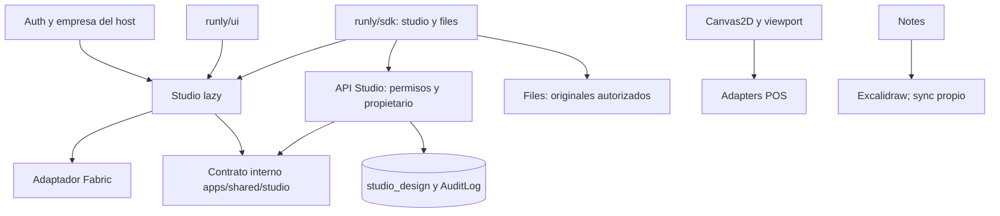

# Runly Studio: auditoría de partida

Fecha: 2026-10-25. La evidencia corresponde al código local indicado; una especificación histórica no prueba que una capacidad esté desplegada.

## Revisiones y alcance observado

| Repositorio | Revisión inspeccionada | Estado y uso |
| --- | --- | --- |
| Runly-MX/runly-erp | `f60c8ed81d88b72947af6cc3b8f4930b81d37fe6` | Base de esta rama. Nueve commits locales sobre `origin/main`, verificado mediante fetch. |
| Runly-MX/runly-erp remoto | `d534a8903238e935ebfd033003386a5d17e5dd57` | Referencia remota observada durante esta ejecución; no se trata como HEAD permanente. |
| canvasocial | `c43ba2eb8e9104eb6cbff45d65b4c4a79c2741ff` | Checkout local con modificaciones previas en CanvasEditorPage; no se copiaron ni modificaron. |
| Atlas-Web-Builder | `598795cd135620baa546cac1459a983ad633e065` | Fuente local 0.2.4, un commit adelantada a su referencia local. El ERP instala 0.2.0. |
| runly-developer-hub | `a5a2bc09305b60516b4e7caa43c535f257dbf25d` | Localizado y revisión identificada; sin cambios ni integración Studio. |

La auditoría técnica se concentra en ERP, Canvas Social y Builder. Runly Web y Atlas ERP histórico no son dependencias de esta vertical. No se verificó su estado remoto ni su ejecución. El workspace original contenía trabajo ajeno en Documents/Automatizaciones: se conservó y se creó un worktree independiente desde el commit base. Ese trabajo sin commit no forma parte de esta implementación.

## Arquitectura existente comprobada

### Canvas y POS

- `apps/desktop/src/modules/runly.canvas/engine/Canvas2DRenderer.js`: Canvas2D imperativo, escena de objetos, viewport, selección, cursores y drawers inyectables. Sus imports incluyen bindings de dominio, iconos, pins y hotspots; mover el renderer completo produciría acoplamiento innecesario.
- `components/CanvasViewport.jsx`: gestos y selección; usa referencias y animation frames durante arrastres. `engine/geometry.js`, `viewport.js`, `groupResize.js` y `snap.js` resuelven la interacción técnica.
- `screens/BoardEditor.jsx`: composición de herramientas, capas, hotspots, historial, bindings y exportación. No equivale a un editor de composición de página fija.
- `hooks/useCanvasData.js`: queries, batches optimistas y reconciliación con revisiones. `lib/history.js` produce operaciones contra las revisiones actuales; no es un CRDT.
- `hooks/useCanvasRealtime.js`: canal privado por Board, Broadcast de cambios, Presence y cursores; aplica deltas o invalida caché. Es específico de Board/Page y de sus query keys.
- `apps/api/src/routes/canvas/canvas-service.js`: Board/Page/Layer/Object, roles por documento, filtros empresariales, batches con expectedRevision y snapshots/versiones. La API aplica permisos globales además del acceso al Board.
- `hooks/useLibraries.js`: bibliotecas personales/empresariales, importadores SVG/ZIP/Excalidraw, límite de 300 SVG por ZIP y 2 MB por SVG. `lib/libraryImport/svg.js` elimina etiquetas y atributos peligrosos; su existencia no constituye una auditoría completa de seguridad de SVG/CSS.
- `lib/exportPage.js` y `renderScene.js`: encuadre por límites de objetos, PNG y PDF raster, resolución limitada. No proporcionan directamente la semántica de página fija de Studio.
- POS importa directamente CanvasViewport, viewport y sceneBounds. `plannerObjects.js`, `floorObjects.js` y `floorDrawers.js` adaptan entidades operativas y dibujos. Se preservan sus imports y contratos.

### Notes

- `components/CanvasEditor.jsx` integra una escena Excalidraw, capas, imágenes y guardado; el stage se carga lazy.
- `lib/SupabaseCanvasSync.js` reconcilia versiones de elementos con `reconcileElements`; transporta cambios, capas, punteros y snapshots. La carga inicial tiene una barrera para no emitir una escena vacía antes de hidratarla.
- `lib/canvasLayers.js` deriva visibilidad/orden sobre elementos Excalidraw y mantiene metadata de capa. No es un modelo genérico de capas para Fabric.
- `lib/canvasImages.js` transforma imágenes embebidas en un manifest de recursos; esa estrategia de almacenamiento es distinta de FileAsset y no se copia.
- `lib/canvasExport.js`: PNG/SVG mediante Excalidraw y PDF raster con jsPDF.
- El proveedor Yjs del texto de Notes y su persistencia son independientes del lienzo Excalidraw. No se sustituye ninguno.

### Automatizaciones

`runly.core/lib/canvasLayout.js`, `flowModel.js` y `components/builder/canvas/` implementan un workspace de nodos con conexiones SVG, posiciones y reglas de flujo. No usan Canvas2DRenderer como motor de escenas.

`packages/module-compiler/src/automations.js` valida flujos contra los contratos de `@runly/module-engine/contracts`; `automation-runtime.js` ejecuta pasos. `system-automations-service.js`, `automation-worker-service.js`, `automation-jobs-service.js` y el worker existente coordinan servicios concedidos, jobs, reintentos y eventos. Studio no registra acciones ni modifica esos contratos en esta entrega. El documento de diseño del 25 de octubre se contrastó con estas implementaciones y con 108 pruebas dirigidas.

### Documents

`documents-hub.js` construye el registro de kinds, el almacén FileAsset, el servicio de plantillas y `document-engine.js`. El registro incluye manual, Growth, HR, contactos, compras, flota, resguardos y certificados LMS. El motor llena DOCX/XLSX/PPTX/PDF y contempla conversión de Office; versiones publicadas, visibilidad personal/empresa y generación son responsabilidad de Documents.

Existen migraciones de engine, adopción de Inventario/LMS, retirada de bloques y visibilidad. Su presencia en Git no demuestra su aplicación en una instalación. No se consultaron bases reales. No se duplica este motor ni se registra un kind gráfico incompleto.

### Canvas Social y Builder

Canvas Social declara Fabric `^6.9.1` y Appwrite, aunque su README histórico mencione otro motor. `CanvasEditorPage.tsx` contiene el editor principal; `FabricCanvas.tsx` tiene un stage más pequeño. `useRealtimeCanvas.ts` carga snapshot y hasta 100 operaciones activas y se suscribe a la colección de operaciones. Esa suscripción no filtra explícitamente canvas_id en el callback: las garantías de acceso no pueden inferirse del cliente. No se reutilizan autenticación, transporte ni código del prototipo. No declara suite de test en package.json; no se certifica su fiabilidad.

Builder tiene un store por editor, historial temporal limitado a 50 estados del documento y separación entre selección/tema y página. Son patrones útiles; su árbol DOM de bloques/regiones y drag-and-drop no corresponden a objetos gráficos. Su licencia declarada es MIT. No se copió código; la diferencia entre fuente 0.2.4 e instalación 0.2.0 impide asumir equivalencia.

## Integración de Runly Studio con los seis paquetes compartidos

Todos declaran versión interna 0.1.0, tipo ESM y distribución privada controlada. Eso no identifica una versión efectivamente publicada en GitHub Packages.

| Paquete | Contratos y dependencias observados | Consumo y cambio de Studio |
| --- | --- | --- |
| core | Registry, identidad, manifests, eventos; entradas browser, native-runtime y labels. Sin motor gráfico. | createModuleManifest y MODULE_KINDS. Se añade exclusivamente la identidad current-only runly.studio; no se inventa atlas.studio. |
| ui | Barrel general; primitives, icons, theme/runtime CSS, adapters e integraciones. React peer; Radix, dnd-kit, Query/Table y otros componentes. | PageHeader, Button, Input, Textarea, FileUploader, EmptyState, ErrorState, Skeleton, ConfirmDialog. Sin cambios al paquete. |
| sdk | createRunlyClient/createAtlasClient; dominios y transporte con token y empresa activa. | Dominio studio aditivo, onlineOnly para no reproducir revisiones antiguas offline. Reutiliza Files. Sin dependencia Fabric. |
| module-engine | Entradas browser/server/contracts; manifiestos, modelos/vistas, servicio y runtime de automatizaciones. Depende de core y alias legacy. | loadHelpBlueprints para la ayuda oficial. Sin modificación. |
| module-compiler | browser/server/contracts/inspection/compile/archive/layout-views; depende de engine, jszip y acorn. | Ningún cambio: Studio es un módulo oficial, no un bundle generado. |
| preview-runtime | Contrato 3, sesiones, resolver, presentation, styles, navegación y custom bundles aislados; UI, React/Query peers. | Ninguno: previews de módulos declarativos no equivalen a exportación gráfica. Excluye files, attachments, backend y SQL transactions. |

Consumidores comprobados: desktop consume core/ui/sdk/compiler/preview-runtime; API y worker consumen infraestructura core/engine y servicios; el fixture independiente consume los seis con alias @runly y @atlas. Los imports legacy se conservan.

### Matriz de responsabilidades y reutilización

| Necesidad | Responsable/contrato existente | Decisión de esta entrega | Nueva biblioteca |
| --- | --- | --- | --- |
| Diseño visual, temas, estados | ui y CSS del host | Reutilización directa | No |
| Formularios e inspector | ui Input/Textarea/Button | Composición interna de Studio | No |
| Drag-and-drop de catálogo | dnd-kit ya presente en UI/desktop | Fuera de primera vertical | No |
| Datos remotos | sdk + TanStack Query del host | SDK Studio, caché por empresa/usuario/diseño | No |
| Auth/empresa | AuthProvider + middleware del host; headers SDK | Identidad validada en servidor, nunca desde JSON de documento | No |
| Servicios/módulos | core manifest + engine contracts | Registro oficial, ayuda y permisos | No |
| Automatizaciones | engine/contracts + compiler y servicios API | Integración documentada, sin registro prematuro | No |
| Escena y transformaciones Studio | Ningún paquete existente; responsabilidad interna de runly.studio | Contrato puro interno API/cliente y adaptador Fabric | No |
| Geometría/viewport Canvas/POS | engine/viewport y geometry existentes en Canvas | Mantener integración existente | No |
| Renderer profesional | Ningún paquete existente; responsabilidad interna de runly.studio | Fabric solo en chunk lazy | No |
| Colaboración | Infraestructura Realtime del host; modelos especializados | Pendiente hasta definir ACL y revocación para Studio | No |
| Assets | sdk.files y files-service | Originales privados FileAsset, referencias autorizadas | No |
| Exportación | Renderer Studio; límites del contrato interno | PNG a resolución de página | No |

Se compararon A (interno Studio), B (utilidades compartidas internas ERP) y C (nuevo paquete graphics). Se elige A para el renderer y B únicamente para el contrato de dominio API/cliente en `apps/shared/studio/`. No se ha extraído código de Canvas, POS o Notes. No hay consumidores independientes ni contrato gráfico maduro que justifiquen C.

### Distribución y compatibilidad

`shared-packages.release.json`, `scripts/lib/shared-package-release.mjs` y el workflow `shared-packages.yml` establecen catálogo cerrado, nombres @runly-mx, alias npm exactos y versiones `<base>-source.<SHA completo>`. El pack toma fuente comprometida con git archive, valida exports/dependencias, excluye tests y comprueba contenido. Publicar exige Actions y entorno protegido; esta entrega no publica ni altera scripts de release.

El mecanismo `verify:shared-consumer` instala tarballs mediante un registro local aislado, comprueba contenido, builds/browser y reinstalación frozen independiente. Se amplía su fixture para probar Studio a través del SDK y su alias. El resultado de la ejecución está en [verificación](runly-studio-verification.md). La aceptación del registro real y las versiones ya publicadas no se verifican con este mecanismo.

## Dependencias, regresiones y decisiones

- Fabric 6.9.1 es dependencia exclusiva de desktop, con resolución exacta y sin actualización de versiones previas del lockfile. Su runtime Node tiene dependencias opcionales nativas; no se activa en API/worker.
- No se crea @runly/graphics ni se agregan dependencias de Studio a Canvas/POS/Notes.
- Nueva tabla SQL propia; sin cambios a prisma/schema.prisma ni a migraciones aplicadas. El despliegue necesita la migración y la sincronización normal del catálogo/permisos.
- La primera vertical es privada al propietario. Presence, cursores, compartidos y propagación multiusuario siguen pendientes de Fase 2; no se anuncian como implementados.
- Las comprobaciones globales de privacidad y transporte fallaban también antes de Studio. Se registran sus resultados y el análisis de archivos nuevos por separado.

La auditoría comprueba contratos y rutas indicados, no demuestra comportamiento completo de instalaciones ni corrige vulnerabilidades históricas. Los escenarios ejecutados, cobertura omitida y medidas están en el informe de verificación.

## Dependencias finales

