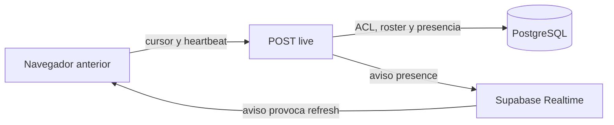
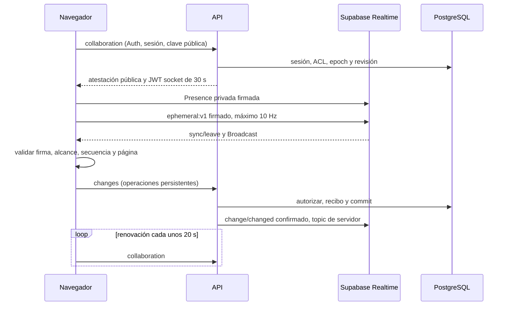

# Studio: optimización local de Presence y Broadcast

## Alcance y evidencia

Trabajo local sobre main, sin despliegue, publicación, SSH ni escrituras en bases
compartidas. Cada E2E crea y destruye su propio proyecto Docker, base, usuarios,
Auth, Storage y Realtime. Los snapshots RC1/RC2 y las migraciones históricas no
se modifican. Los datos crudos, capturas y logs sintéticos quedan ignorados bajo
`.artifacts/studio/realtime/` y los directorios desechables del verificador.

Versiones probadas: Realtime v2.102.3, Auth v2.189.0, supabase-js 2.105.1 y
PostgreSQL 17.6. La referencia del hook anterior es `0c870ba2`; el bootstrap API
local explícito es `runly-studio-v7:ad3977d5-api`. El runner aplica fuentes nuevas
solo dentro de contenedores identificados como desechables; no reemplaza esa
imagen ni sus etiquetas. El benchmark es del transporte React real y el motor
sync, sin Fabric. Las regresiones visuales se ejecutan con el frontend completo.

## Arquitectura

Antes: cada cursor/selección programaba `/live` aproximadamente cada 200 ms;
un heartbeat de 2.5 s y los avisos de presencia provocaban más peticiones. Cada
live reautorizaba, escribía `studio_presence` y recuperaba roster, perfiles,
avatares y revisión. Se combinaban Broadcast y tráfico HTTP repetitivo.



Ahora: Presence administra sesiones conectadas; Broadcast transporta estado
efímero firmado. HTTP autoriza al entrar y renueva una capacidad limitada cada
unos 20 s con jitter. La renovación devuelve ACL, revisión y metadatos de páginas,
sin el documento completo ni roster. Los cambios de edición permanecen en la API.



No se agrega un servidor, Redis ni un segundo sistema de persistencia. Hay una
conexión dedicada al mismo Supabase para la credencial efímera. Es necesaria para
no reemplazar el token del singleton compartido con Notes/Canvas/Chat; ese
singleton conserva el canal persistente de Studio. El wrapper HTTP compartido de
esos módulos no se modifica.

| Canal/operación | Autoridad y datos |
|---|---|
| `studio:ephemeral:<id>@<epoch>` privado | Presence y Broadcast cliente, estado firmado, sin documento |
| `studio:design:<id>@<epoch>` privado | Solo servidor publica cambios confirmados |
| `/collaboration` | Auth, membresía, permiso, ACL, sesión y capacidad de 30 s |
| `/changes` | Operaciones v7/protocolo 3, recibos, autorización y revisión |
| `/live` | Compatibilidad temporal para clientes anteriores |

Presence solo cambia al entrar, renovar, cambiar página/actividad y salir; tiene
coalescing de 1 s. El cursor conserva solo la última posición, distancia mínima
1 px, máximo 10 Hz, una firma/envío en vuelo y una muestra pendiente. Sin otro
participante activo en la misma página no transmite movimientos. Selección y
página conservan prioridad al combinarse con el ratón. El store externo actualiza
solo el overlay existente; roster y selección actualizan React cuando cambian.
La interpolación CSS existente permanece. Sin locks ni eventos en historial.
Broadcast codifica el estado firmado en una tupla de 11 posiciones con orden
fijo; el receptor reconstruye el objeto cerrado antes de verificar su firma.
Presence conserva la atestación y el objeto firmado. Se eliminan nombres de
campos repetidos en cada entrega, sin quitar identidad, secuencia ni geometría.

## Seguridad y revocación

Un canal privado no autentica los campos del mensaje. Cada montaje crea una clave
ECDSA P-256 con parte privada no exportable. La API verifica el JWT Auth vigente,
su sesión activa, perfil, empresa, `studio.view` y ACL del diseño; firma con
Ed25519 una atestación de clave, actor, nombre, rol, empresa, diseño, sesión,
epoch y caducidad. La clave de atestación deriva del secreto JWT self-hosted con
separación de dominio; solo la clave pública llega por contexto autorizado.
Sin configuración compatible la capacidad falla cerrada.

Cada receptor verifica atestación y firma del estado, campos cerrados, tipos,
2 KiB, coordenadas finitas dentro de una página válida, timestamp y secuencia.
Se rechazan suplantación, secuencias ya conocidas, mensajes fuera de orden y ámbitos ajenos. Los
caches están acotados: 100 sesiones activas, 1,000 secuencias con expiración,
20 verificaciones por sesión/segundo y renovación limitada por actor. Un emisor
autorizado puede mentir sobre su propio cursor, nunca atribuirlo a otro actor.
Los avatares remotos usan iniciales; no se difunden URLs firmadas, tokens,
documentos ni HTML. La atestación pública no es una credencial API.
Un observador nuevo puede recibir un estado genuinamente firmado anterior a su
entrada: el límite de antigüedad es 5 s en Broadcast y la vida restante del lease
en Presence (máximo 30 s). No se presenta esa prueba como garantía de actividad
física actual ni como autorización para persistir. Las secuencias conocidas no
pueden retroceder, incluso después de un leave y replay en el mismo receptor.

El rol `runly_studio_socket` es NOLOGIN/NOINHERIT, sin privilegios de negocio ni
membresía en authenticated/anon/authenticator. Su JWT no tiene `sub`, dura como
máximo 30 s y nunca supera la caducidad del Auth original. RLS comprueba tema
exacto, empresa, diseño, epoch y sesión. Sus únicas políticas son SELECT/INSERT
para Presence/Broadcast. `runly_realtime_server_writes` sigue restrictiva/false
para authenticated/anon. No puede publicar cambios persistentes ni reutilizarse
como Auth, API o Data API.

Revocar bloquea inmediatamente nuevas capacidades, suscripciones y escrituras
autorizadas. El epoch rota y los cambios confirmados dejan de publicarse en el
topic anterior. Realtime conserva grants de conexiones existentes: el experimento
malicioso **sí recibió** un evento tras revocar y perdió el socket al vencer el
JWT, observado en 30.8 s incluyendo temporización del servidor. El límite de la
credencial es 30 s desde su emisión; no se promete expulsión instantánea ni
precisión subsegundo de la detección de cierre. La UI honesta mostró la revocación
en 20.78 s en el E2E final. No hubo escritura posterior aceptada y el borrador
pendiente permaneció disponible. Las capacidades privadas de imágenes ya emitidas
conservan su vencimiento propio; nuevas solicitudes revalidan el acceso.

La caducidad local retira ambos canales aun si el API está caído. 401 retira
capacidades y permite renovar Auth; 403/404/426 suspende colaboración y preserva
el borrador. Fallos transitorios usan una petición en vuelo, watchdog de 8 s,
AbortController, backoff y jitter. Reconectar revalida y reconcilia revisión.
Ocultar retira Presence y detiene cursor, conservando solo renovación de seguridad.
No existe fallback HTTP por movimiento. El cierre libera canales propios,
listeners y timers; el singleton puede quedar abierto para otros módulos.

## Provisión y compatibilidad

No se ejecutó este procedimiento contra ninguna instalación compartida.

El cliente incluye `patches/@supabase__realtime-js@2.105.1.patch`, registrado en
pnpm y su lock sin cambiar versiones de dependencias. El adaptador de esa versión
modificaba las metas originales al borrar `phx_ref` para preparar callbacks de
join/leave; Phoenix dejaba de retirar referencias y acumulaba historia en el
roster nativo. La prueba prolongada lo reprodujo y el parche copia cada meta
antes de transformarla. Una regresión con 150 renovaciones exige una sola meta
actual y ninguna después de leave. Los Dockerfiles de API, Web y Worker copian
el parche antes de `pnpm install --frozen-lockfile`; omitirlo rompe el build.
Reevaluar el parche al actualizar Supabase, verificando el
[adaptador original fijado a 2.105.1](https://github.com/supabase/supabase-js/blob/v2.105.1/packages/core/realtime-js/src/phoenix/presenceAdapter.ts)
y repitiendo regresión y carga real. No se modifica el protocolo de Phoenix.

1. Para una base existente, ejecutar explícitamente la fase propietaria
   `node prisma/provision-studio-realtime-role.mjs` con
   `SUPABASE_ADMIN_DATABASE_URL` suministrada de forma privada. No carga `.env`,
   no tiene host por defecto ni imprime conexión. El propietario debe poder
   conceder USAGE sobre `realtime`; el rol de migraciones no puede asumirlo.
2. Aplicar la migración nueva `20261210000000_studio_realtime_ephemeral` antes
   de habilitar Web. Falla explícitamente si falta la fase propietaria o el rol
   tiene privilegios/membresías incompatibles. No modifica SQL histórico.
3. Configurar Realtime y reiniciar/recrear el contenedor según su procedimiento
   operativo. Installer declara estos límites por defecto:

| Variable | Valor |
|---|---:|
| `RUNLY_REALTIME_MAX_EVENTS_PER_SECOND` | 2000 |
| `RUNLY_REALTIME_MAX_BYTES_PER_SECOND` | 2000000 |
| `RUNLY_REALTIME_PRESENCE_MAX_CALLS` | 30 |
| `CLIENT_PRESENCE_WINDOW_MS` | 30000 |

Los defaults originales 100 eventos/s y cinco Presence/30 s provocaron throttling
real en las pruebas; esas muestras se excluyen del resultado final. El seed de
Realtime no actualiza tenants existentes. La provisión permite cambiar límites
solo cuando se especifica `RUNLY_REALTIME_TENANT_ID`: exige coincidencia exacta de
un tenant existente, sin seleccionar uno automáticamente. Revisar/reiniciar el
servicio para cargar configuración y caches conforme a la versión instalada.
Las bases nuevas reciben la fase propietaria mediante el init SQL del Installer.

API, SQL y provisión primero; Web después. Mantener `/live` durante la transición.
Clientes antiguos y nuevos comparten cambios persistentes en ambos sentidos;
sus rosters efímeros están separados hasta recargar pestañas antiguas. El protocolo
efímero 1 es independiente del persistente 3. Un cliente protocolo 2 continúa
recibiendo 426 al intentar sobrescribir v7. No habilitar Web nuevo contra API viejo.
Para rollback de Web, mantener API/SQL compatibles y `/live`; no borrar el rol ni
revocar permisos con clientes nuevos conectados. No se realizó rollback ni release.

## Reproducción

El runner exige una imagen bootstrap local explícita y comprueba la identidad
del proyecto/base desechable antes de escribir. No usa las variables de despliegue.

```sh
node scripts/measure-studio-realtime.mjs --phase=before --seconds=60 --source-ref=0c870ba2 --api-image=runly-studio-v7:ad3977d5-api
node scripts/measure-studio-realtime.mjs --phase=after --seconds=60 --api-image=runly-studio-v7:ad3977d5-api
node scripts/measure-studio-realtime.mjs --phase=after --seconds=5 --scenario=none --security --e2e --outage-seconds=120 --api-image=runly-studio-v7:ad3977d5-api
node scripts/measure-studio-realtime.mjs --phase=after --seconds=180 --scenario=cursor-10 --retained-heap --result=load-10 --api-image=runly-studio-v7:ad3977d5-api
node scripts/verify-studio-local.mjs --tests-only
node scripts/verify-studio-supabase.mjs --operations-only --include-multipage --current-realtime --source-ref=HEAD --api-image=runly-studio-v7:ad3977d5-api
```

La integración final utilizó las imágenes construidas desde Git, mediante:

```sh
node scripts/verify-studio-supabase.mjs --operations-only --include-multipage --api-image=runly-studio-realtime:df739fe4-api --web-image=runly-studio-realtime:df739fe4-web --worker-image=runly-studio-realtime:df739fe4-worker
node scripts/measure-studio-realtime.mjs --phase=after --seconds=5 --scenario=none --security --e2e --native-lifecycle --outage-seconds=120 --result=final-current --api-image=runly-studio-realtime:df739fe4-api
```

Usar un HEAD que incluya esta implementación para la última orden. El overlay de
fuente comprometida evita incorporar cambios visuales ajenos del workspace sin
checkout ni worktree. El runner evita el timeout artificial de 3 s de WebSocket
del fixture genérico: usa 60 s únicamente para WS, conserva los demás fallos HTTP.
Los valores de bytes WS decodifican frames binarios; HTTP informa cuerpos y,
por separado, tamaños de transferencia incluyendo headers. La CPU se obtiene
de cgroup de API/PG y CDP TaskDuration para el navegador. SQL usa estadísticas
físicas de presencia y pg_stat_statements; los probes RLS de Realtime sí ejecutan
SQL al autorizar/renovar, aunque no hay escritura por cursor ni por sesión nueva.

La latencia de cursor mide input a store/efecto React remoto, no paint final del
canvas ni una prueba WAN. Los tiempos de join miden canales conectados; los E2E
también esperan roster y verifican leave. El escenario `hidden` de carga cambia
visibilityState sintéticamente y se identifica como tal; no equivale a suspender
el sistema operativo. Las métricas son locales, sin promesa de capacidad universal.

## Mediciones y validación

Muestras de 60 s, tráfico agregado de todos los navegadores. La referencia final
antes/después es `before-matrix.json` / `after-patched.json` en los artefactos
ignorados. El transporte sano se midió en `f8ab3bb8`; `df739fe4` corrige después
la limpieza de conexiones caídas sin cambiar ese tráfico sano. Las imágenes
finales e integración completa corresponden a `df739fe4`.
Una pasada intermedia sin compactar reducía HTTP pero
aumentaba el ancho de banda total con diez usuarios; se corrigió antes de cerrar.

| Escenario | `/live` antes → después | Renovaciones nuevas/min | INSERT+UPDATE `studio_presence` antes → después | SELECT de presencia antes → después |
|---|---:|---:|---:|---:|
| Reposo, 1 | 48 → 0 | 3 | 24 → 0 | 72 → 0 |
| Cursor, 1 | 422 → 0 | 3 | 212 → 0 | 654 → 0 |
| Cursor, 5 | 1845 → 0 | 15 | 815 → 0 | 2756 → 0 |
| Cursor, 10 | 3276 → 0 | 30 | 1744 → 0 | 5258 → 0 |

Con diez usuarios se reduce 99.1% el número de peticiones de presencia/control
(3276 live frente a 30 contextos). Las consultas de revisión asociadas al control
bajan de 5061 a 30; con cinco, de 2683 a 15. No hay `/current` ni consultas HTTP
de revisión adicionales en estos escenarios. El contexto incluye la revisión
para reconciliar. SQL total no es cero: por ejemplo, diez cursores registraron
872 llamadas pg_stat_statements/383 ms, incluyendo autorización, transacciones
y trabajo de los servicios locales. No se atribuye todo ese tráfico al cursor.

| Cursor | HTTP transferido antes → después | WS enviados+recibidos antes → después | Total antes → después | Reducción total |
|---|---:|---:|---:|---:|
| 1 | 978878 → 11052 B | 50412 → 11949 B | 1.029 → 0.023 MB | 97.8% |
| 5 | 5900472 → 55266 B | 983910 → 4132496 B | 6.884 → 4.188 MB | 39.2% |
| 10 | 14060698 → 110544 B | 4183600 → 15784501 B | 18.244 → 15.895 MB | 12.9% |

El fan-out firmado a mayor frecuencia incrementa WS y reduce mucho HTTP. La
mejora de ancho de banda es menor con diez usuarios; no se afirma que Broadcast
elimine el coste N×N de entregar cursores a los demás participantes. Se omiten
movimientos cuando nadie más está activo en la página. En reposo el total baja
de 0.117 MB a 0.023 MB/min. Los tamaños no incluyen TLS/TCP/IP: son cuerpos y
headers HTTP medidos por Chrome y payloads de frames WS decodificados.

| Cursor | CPU API antes → después (s/min) | CPU PG antes → después (s/min) | Cursor p50/p95 antes → después (ms) | WS enviados/recibidos después (frames/s) |
|---|---:|---:|---:|---:|
| 1 | 4.705 → 0.109 | 6.167 → 0.580 | Sin destinatario | 0.17 / 0.17 |
| 5 | 14.454 → 0.455 | 33.245 → 1.455 | 230/831 → 25/121 | 45.75 / 226.27 |
| 10 | 26.004 → 0.513 | 88.688 → 1.186 | 275/1366 → 21/116 | 91.50 / 904.50 |

Los frames incluyen control, ack, Presence y ambos canales. El emisor efímero
opera aproximadamente a 9 Hz por sesión bajo el límite de 10 Hz. Con 5/10 usuarios
se observaron cero descartes, acks fallidos o reconexiones y 4/9 sesiones remotas
por navegador. El join posterior quedó en 112–158 ms para cinco y 141–210 ms para
diez; no equivale a tiempo de carga completo de Studio. El E2E inicial observó
cursor en 108 ms y salida de pestaña en 31 ms con polling del test cada 100 ms.

La CPU se desplaza parcialmente al navegador por verificación de firmas y mayor
frecuencia visual. CDP TaskDuration agregado del fixture subió de 5.75 a 17.56 s
con cinco y de 14.86 a 75.94 s con diez, mientras API/PG se redujeron fuertemente.
Realtime nuevo consumió 2.65/6.44 s respectivamente. No se reporta reducción de
CPU del navegador ni un benchmark completo de Fabric: la instrumentación del
fixture observa todos los participantes y registra posiciones, y añade coste.
Las pruebas prolongadas acotan esos registros y separan heap retenido tras GC
y limpieza de logs de la memoria ocupada por la instrumentación.

Matriz auxiliar anterior de 60 s (`before-final.json`, gateway WS de 60 s) y
pasada nueva compacta:

| Escenario | `/live` anterior → nuevo | Contextos nuevos | Escrituras de presencia nuevas |
|---|---:|---:|---:|
| Dos editando | 1012 → 0 | 6 | 0 |
| Páginas distintas | 1087 → 0 | 6 | 0 |
| Dos pestañas del mismo usuario | 1116 → 0 | 6 | 0 |
| Oculta, señal sintética | 545 → 0 | 3 | 0 |

Las escrituras de edición reales continúan: «cero» en esa tabla se refiere solo
a `studio_presence`. Con dos editores el cursor nuevo dio p50/p95 3/4 ms y con
dos pestañas 3/10 ms. No se interpreta la latencia de coordenadas de páginas
distintas como latencia de cursor visible: allí el movimiento se suprime y solo
se anuncian metadatos de página/actividad.

### Carga prolongada y límites

La pasada `load-10-fixed.json` mantuvo movimiento durante **180 s con diez
usuarios**: 16,163 emisiones y 145,467 entregas esperadas/observadas, cero
descartes, acks fallidos o reconexiones; nueve sesiones remotas y exactamente diez
metas nativas por navegador, ninguna caducada. `/live`, lecturas y escrituras de
`studio_presence`: cero. Se registraron 88 renovaciones, p50/p95 de cursor
41/119 ms, CPU API 2.05 s, PG 3.35 s y Realtime 16.05 s durante los tres minutos.
El heap retenido tras GC y limpiar los logs del fixture quedó en 4.62–4.66 MB
por navegador frente a 3.74–3.91 MB tras conectar. No se presenta una muestra
de tres minutos como prueba de ausencia de toda fuga durante horas; también se
comprueban límites explícitos de caches y la regresión de 150 renovaciones.

**Veinte usuarios no quedaron aprobados.** Se intentó carga controlada con
5,000 eventos/s y 5 MB/s en Docker local de cuatro CPU/5.16 GB. Aparecieron abortos
del contexto por el watchdog de 8 s, caducidades/reconexiones y descartes; algunas
pasadas terminaron con 18 de 19 participantes remotos. Se reprodujo también sin
GC forzado, por lo que no se atribuye la causa al perfilador ni se afirma que
aumentar solo los límites de Realtime lo resuelva. Los artefactos de diagnóstico
fallidos se conservan; no se usan como muestras aprobadas. Queda pendiente
diagnosticar y volver a validar esa carga antes de afirmar soporte para veinte
usuarios por diseño. No se prolongó una credencial ni se relajó RLS para aprobarla.

En el medidor, las coordenadas de dos pestañas del mismo actor se correlacionan
por **sesión**, no solo por userId; usar userId mezclaba ciclos de coordenadas y
producía un p95 falso. La pasada corregida `same-user-latency.json` observó
3/10 ms, 1,082 entregas esperadas/recibidas y cero descartes. El escenario de
páginas distintas suprime cursores entre páginas y solo intercambia metadatos;
su correlación de coordenadas no representa latencia visual.

### Pruebas de la revisión

- Unitarias nuevas de contrato, firmas, formato compacto, throttle, coalescing,
  orden, página, expiración, 401, revocación, desmontaje, timers y SDK: **17/17**.
- Regresión aislada final con PostgreSQL real: **1462 pruebas, 1461 aprobadas,
  una omitida preexistente, cero fallos**. Incluye
  Studio, Files, permisos, Canvas, Notes, plantillas, historial y recibos.
  Una pasada anterior congeló 19 archivos ajenos en memoria sin alterar el
  workspace. El fallo transitorio de `projects.task.created` de esa otra sesión
  dejó de aparecer después de sus commits; no se corrigió ni se ocultó aquí.
- MCP global: **208 pruebas, 189 aprobadas, 17 fallos, dos omitidas**. Los 17
  nombres de fallo son idénticos al ejecutar el código anterior a esta tarea;
  no se agregaron skips. El E2E propio usa además OAuth/PKCE y aprobación/commit
  MCP reales sobre el diseño desechable, verificando convergencia.
- React Doctor, scope changed contra `dab0e1cb`: **cero diagnósticos nuevos**,
  salida 0 (puntuación general 80/100; no se interpreta como puntuación perfecta).
- Política de propiedad de esquemas Supabase: aprobada.
- ESLint global: salida 0. Instalación pnpm frozen con el parche: aprobada, sin
  actualizar versiones de dependencias.
- Privacidad global: **67 hallazgos preexistentes**, contabilizados aparte;
  ningún secreto ni valor encontrado se copia al informe.

La regresión final incluye la prueba de caducidad durante limpieza offline.
Los 38 archivos de esta entrega tienen **cero hallazgos propios de privacidad**.

### Integración e imágenes reales

- Builds locales de **API, Web y Worker** desde `git archive df739fe4`, etiquetas
  nuevas `runly-studio-realtime:df739fe4-{api,web,worker}`, con la revisión completa
  en labels. Sin `.env` del workspace, cambios ajenos ni modificación de imágenes
  certificadas. No se subieron imágenes.
- API y nginx Web de esas imágenes, SQL/Auth/Storage/Realtime reales: **13 grupos
  de operaciones/recibos/plantillas/seguridad, cuatro de degradados, cuatro de
  fotografías, cinco de fotografías en formas y ocho multipágina**, aprobados.
  Texto/PDF de 1/4/16 páginas, dos sesiones y verificación independiente de PDF
  también pasaron. El bundle se inspeccionó contra secretos de servidor; el
  Worker de la misma revisión arrancó y siguió activo sin errores de imports.
- Seguridad real: scoped role, RLS, Auth/anon/otra empresa/diseño, ausencia de
  privilegios de tablas de negocio, token no reutilizable por API/Data API,
  aislamiento de topic público/privado, VIEWER y caducidad de socket: aprobados.
- E2E final con API `df739fe4`, ocho grupos: Presence, suplantación/replay,
  StrictMode, tabs, selección/borrado/página, operaciones simultáneas, MCP,
  compatibilidad antigua, Auth refresh, caída de Realtime **120 s**, API caída
  con WS sano, revocación con trabajo local pendiente y limpieza final: aprobado.
  Cursor observado 124 ms; salida 117 ms; UI revocada 20.78 s; reconexión observada
  21.16 s después de que Realtime volvió a estar disponible. El límite del test
  es 60 s, no una promesa de recuperación inmediata.
- Se ejercitaron minimizar ventana y cambiar pestaña en Chrome con ventana;
  Chrome automatizado conservó visibilityState visible. Se probó explícitamente
  la rama hidden con señal sintética. Una pausa de JavaScript **35 s**, confirmada
  por Debugger.paused, hizo vencer la capacidad y preservó cambios locales y
  remotos al continuar. **No se suspendió el sistema operativo** del usuario.

La prueba de desconexión encontró otra carrera: el timer del lease anterior podía
eliminar el nuevo mientras esperaba un unsubscribe sin red. Ahora se sustituye
el timer antes de ese await y se vincula a la concesión concreta. La regresión
determinista falla con `f8ab3bb8` y pasa con `df739fe4`. También se prueba que una
firma antigua en vuelo no consuma el anuncio de Presence de una credencial nueva.

## Archivos y commits

El cambio principal está en el hook/controlador/store y overlay de Studio,
`apps/shared/studio/realtime.js`, la fábrica API `studio-realtime.js`, la proyección
de acceso y SDK. Se añaden la migración y provisión propietaria, configuración
Installer, parche pnpm y su inclusión en los tres Dockerfiles. Los runners y
fixtures conservan datos sintéticos ignorados. Contrato UI, spec y plan se
actualizan; los archivos ajenos de otras sesiones se preservan.

Commits de implementación y verificación en main:

- `24085d52`: transporte efímero autorizado, PKI, rol, hook y pruebas iniciales.
- `bdb766d8`: mensajes firmados compactos y verificaciones de ciclo de vida.
- `cd383341`: corregir referencias nativas Presence mediante parche versionado.
- `f8ab3bb8`: evitar que una firma antigua pierda la renovación de Presence.
- `df739fe4`: conservar el lease renovado durante limpieza offline; verificar
  imágenes reales y ampliar diagnósticos y pruebas.

La validación se limita al entorno local descrito. Requiere provisión y SQL antes
de Web; el despliegue, una prueba real de suspensión del SO y la aprobación de
la carga de veinte usuarios no se realizaron ni se presentan como aprobados.

## Fuentes primarias

Se verificaron [autorización Realtime](https://supabase.com/docs/guides/realtime/authorization),
[Presence](https://supabase.com/docs/guides/realtime/presence),
[protocolo](https://supabase.com/docs/guides/realtime/protocol) y el
[código fijado a v2.102.3](https://github.com/supabase/realtime/tree/v2.102.3).
La autorización cacheada y la caducidad se contrastaron experimentalmente, sin
suponer que cada campo de un Broadcast queda autenticado por el canal privado.
