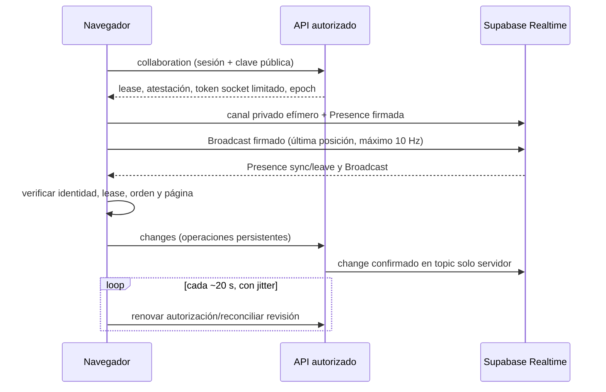

# Studio: evolución del transporte de colaboración

## Alcance y línea base

Local, main, sin despliegues, bases compartidas ni imágenes certificadas alteradas.
HEAD inicial `0c870ba2`. Cambios concurrentes de catálogo/importación/UI se preservan.
El hook actual combina cursor HTTP a 200 ms, heartbeat a 2500 ms y refresh por
broadcast. Cada live escribe SQL, consulta roster, avatares, ACL y revisión.
La matriz base registra unas 49 llamadas live/min en reposo y 466 al mover el
cursor. Se mide con Chrome y Auth/SQL/Realtime reales y desechables; las muestras
preliminares con timeout de WebSocket de 3 s se descartan del resultado final.

## Separación de responsabilidades

El protocolo persistente v7/3, changes, recibos, auditoría, drafts e historial se
conservan. Solo el servidor publica change/changed después del commit en el topic
existente studio:design:<id>@<epoch>. Ningún mensaje efímero llega a sync.receive.
La presencia pasa a Supabase Presence; el movimiento y selección a Broadcast.
No se añade otro servidor, Redis ni escritura SQL por movimiento o sesión nueva.

## Identidad y políticas

Un payload arbitrario en un canal privado no acredita autoría. Cada montaje crea
un par ECDSA P-256 no exportable. POST collaboration verifica acceso y firma una
atestación pública Ed25519 de sessionId, clave pública, nombre, rol, actor, empresa,
diseño, epoch e intervalo de validez. La atestación no es un bearer token y no
concede acceso a ninguna API. Presence transporta esa prueba y el estado firmado;
Broadcast solo el estado firmado. El receptor verifica ambas firmas, alcance,
caducidad, secuencia, timestamp, tamaño y geometría. No toma userId/nombre/rol de
campos libres, ni ejecuta texto. No transmite URLs firmadas, documentos ni tokens.

La política global runly_realtime_server_writes queda intacta. Una migración
aditiva crea el rol NOLOGIN/NOINHERIT runly_studio_socket, sin membresía de
authenticated/anon y sin acceso a tablas de negocio. Sus únicas políticas son
SELECT/INSERT Presence/Broadcast para studio:ephemeral:<design>@<epoch>, con
claims de alcance y acceso actual comprobados en una función privada. No puede
publicar change/changed en los topics persistentes, ni suscribirse a otros diseños.
La API emite JWT exclusivo para ese rol, máximo 30 segundos, nunca mayor que el
JWT Auth de origen. No contiene sub de usuario Auth y no autentica contra el API,
Storage o Data API. Su uso y rechazo se prueban experimentalmente.

Se usa una conexión Supabase Realtime separada exclusivamente para esta credencial
limitada: cambiar la autenticación del singleton afectaría Notes/Canvas/Chat. No es
otro servidor WebSocket. El canal persistente reutiliza el singleton existente.
La clave de atestación se deriva, con separación de dominio, del secreto JWT local
que ya posee el API; solo su clave pública llega por HTTPS. Sin secreto compatible
la capacidad falla cerrada. No se introduce un secreto público ni en archivos.

## Lease, renovación y revocación

Lease máximo 30 s, renovación a unos 20 s con jitter y petición única en vuelo.
No se consulta roster HTTP. La renovación devuelve revisión, permisos, epoch y
páginas, permitiendo reconciliar cambios perdidos. Recibir Presence no llama HTTP.
La caducidad detiene publicación y recepción incluso si el API está caído; un
403/404 bloquea sync preservando el borrador. Un 401 limpia capacidades y espera
la renovación Auth, sin confundirla con una revocación de ACL. Fallos transitorios no equivalen
a revocación: backoff y recuperación sin descartar el outbox.

Las mutaciones ACL rotan el epoch existente. El servidor deja inmediatamente de
publicar cambios persistentes en el topic anterior. Realtime almacena grants en
la conexión: no se promete expulsión inmediata. Los clientes honestos dejan el
topic efímero antiguo al renovar o caducar, como máximo 30 s desde su última
autorización; además se mide el comportamiento real de JWT/canales en v2.102.3.
La API de operaciones y de imágenes revalida cada solicitud y no cambia.

## Flujo y ciclo de vida

Cursor: coalescing, distancia mínima, secuencias monotónicas, una firma/envío en
vuelo y última muestra pendiente. Selección solo al cambiar; cambio de página
limpia cursor/selección anterior. Presence solo al entrar, renovar, cambiar página
o actividad. Untrack al ocultar/salir y expiración/disconnect para cierres abruptos.
Presence tiene su propio coalescing de 1 s; nunca sigue la frecuencia del ratón.
No hay colas ilimitadas. Receptor acotado por sesiones y frecuencia.

Cursores actualizan un store externo que escucha el overlay existente; el editor
completo no se renderiza por cada movimiento. Roster/selección/página solo causan
cambios React cuando difieren. Se conserva el color local y no se crean locks.
Los eventos no pertenecen al documento ni al historial.

Limpieza: AbortController, canales/timers/listeners por generación, deduplicación
de reautorización/reconexión, y StrictMode sin sesiones duplicadas persistentes.
WebSocket caído: rejoin/backoff y reconciliación HTTP; no HTTP de cursores como
sustituto. Renovación Auth actualiza el token HTTP, no reinicia el outbox.

## Compatibilidad y pruebas

Protocolo efímero v1 independiente del protocolo persistente 3. Se mantiene live
para clientes anteriores, sin cambiar sus límites/ACL. Los clientes nuevos requieren
API y migración nuevos: capacidad ausente da aviso de actualización y falla cerrada,
no cae a cursor HTTP. Clientes viejos/nuevos comparten cambios persistentes; su
presencia efímera usa transportes distintos durante la transición. Actualizar API
y SQL antes de Web. No mezclar atestaciones de epochs distintos.

Runner antes/después equivalente: 1, 2, 5, 10 usuarios, páginas distintas, dos tabs,
reposo, edición real, HTTP/WS bytes/eventos, pg_stat_statements, presencia física,
CPU API/PG/navegador y latencia. E2E adicional: auth real, spoof, replay, expiración,
revocación, desconexión, pérdida API, renovación, mount/unmount, MCP y multipágina.
No afirmar que una prueba de UI por sí sola demuestra autorización.

Fuentes primarias: [autorización Realtime](https://supabase.com/docs/guides/realtime/authorization),
[Presence](https://supabase.com/docs/guides/realtime/presence),
[protocolo](https://supabase.com/docs/guides/realtime/protocol),
[diseño de RLS y claims](https://github.com/orgs/supabase/discussions/22484).
El changelog Markdown no pudo leerse con la herramienta web (MIME no soportado);
se verifican documentación actual, dependencias locales y servidor desechable.

## Provisión y capacidad

La fase propietaria `prisma/provision-studio-realtime-role.mjs` requiere una URL
administrativa explícita y debe preceder a la nueva migración en instalaciones
existentes. La inicialización de instalaciones nuevas incluye el SQL propietario.
No puede sustituirse por un GRANT emitido desde el rol postgres: el esquema
Realtime pertenece a supabase_admin. La migración verifica esta condición.
El rol no es miembro de authenticator ni tiene privilegios de negocio.

Realtime v2.102.3 limita por defecto a 100 eventos/s y cinco llamadas Presence
cada 30 s. El Installer declara 2,000 eventos/s, 2 MB/s y 30 Presence/30 s; el
cliente permanece limitado a 10 Broadcast/s y una actualización Presence/s.
Las variables de seed solo configuran tenants nuevos. La provisión permite
actualizar un tenant existente identificado explícitamente, sin elegir uno por
defecto; las variables de Presence requieren recrear el contenedor.

El contexto consulta solo ACL, revisión y dimensiones de páginas, sin transmitir
el documento entero en cada renovación. Los avatares remotos utilizan las
iniciales existentes; no se distribuyen URLs privadas en el canal efímero.

## Corrección necesaria del SDK instalado

La carga prolongada reveló que el adaptador Presence de realtime-js 2.105.1
elimina `phx_ref` del tracker al preparar callbacks públicos. Phoenix ya no puede
retirar esas metas y las renovaciones acumulan estados históricos. Se incorpora
un parche pnpm versionado que copia la meta antes de transformarla, sin cambiar
protocolos ni permisos. Una prueba con 150 actualizaciones y leave exige una sola
meta actual y cero al salir. Los tres Dockerfiles copian el parche antes del
install frozen. Al actualizar Supabase hay que reevaluar y retirar este parche
solo cuando la versión nueva supere esa prueba y la carga real prolongada.
