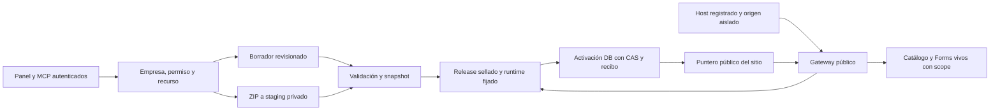

# Website Recovery — contratos y arquitectura propuestos v1

**Contratos disponibles del cierre funcional, 2026-11-02:** [DTO y rutas efectivos C-1–C-5, FormScope Website/Growth y captura publicada](2026-11-02-website-backend-contracts.md). Extienden las fachadas existentes sin `/website/v1` paralelo. Las solicitudes históricas que siguen no acreditan otras capacidades: Calendar permanece bloqueado por falta de contrato público; los mapas ambiguos no se resuelven automáticamente. [Pruebas, compatibilidad y alcance APTO en laboratorio](../evidence/2026-11-02-website-recovery/backend-functional-block-results.md). Website sigue NO APTO E2E.

**Cierre S4, 2026-11-02:** importación ZIP privada `static-v1`, preview con grant aislado y publicación por releases S3 implementadas sobre `efce9ea5586340a53920f0561b74bc38d0919fab`. Builder npm fijado a **0.2.4**, con comparación de API/documentos, navegador y reversión. **APTO en laboratorio para S4; S1/S2/S3 conservados; Website NO APTO E2E.** [Contratos efectivos, matriz de seis builds, aislamiento, migración y límites](../evidence/2026-11-02-website-recovery/import-preview-block-results.md). 81/81 PostgreSQL por versión 17/18, 267/267 regresiones y 8/8 navegador. Sin DNS/TLS públicos ni despliegue. FormScope/Calendar, integraciones dinámicas de preview y corpus real siguen pendientes. El diseño de Claude en `docs/superpowers/design/` no fue modificado; Codex cierra S4 y no implementa la interfaz siguiente. Las notas anteriores se conservan como historia, subordinadas a este cierre para el alcance implementado.

**Cierre S3, 2026-11-02:** releases inmutables, activación CAS/idempotente, rollback, retirada y gateway estricto implementados sobre `532f9351e7f6fc3960be8baa58d1aeede065e71e`. **APTO en laboratorio para S3; S1/S2 conservados; Website NO APTO E2E.** [Contratos efectivos, migración, pruebas y límites](../evidence/2026-11-02-website-recovery/publication-block-results.md). 61/61 pruebas PostgreSQL por versión 17/18 y 234/234 regresiones seleccionadas. Hostnames reales pendientes, FormScope/Calendar bloqueados para nuevas publicaciones, ZIP sin ejecución hasta S4. Atlas-web-builder sigue 0.2.0; no hay diseño, DNS o despliegue. **S4 no iniciado.** Las notas anteriores se conservan como historia y quedan subordinadas a este cierre para el alcance implementado.

**Estado S2, 2026-11-02:** [contratos de identidad y borradores efectivamente disponibles](../evidence/2026-11-02-website-recovery/identity-draft-block-results.md). Se recuperaron las fachadas actuales `/website/sites` y `/website/pages` con selección explícita de sitio, default persistido, revisión CAS, SEO/metadatos privados e idempotencia de comandos. La migración aditiva incluye RLS backend-only y pertenencia compuesta; solo se ejecutó en PostgreSQL desechable. No se creó una segunda API `/website/v1` ni el SiteDTO completo objetivo. Publicación, releases, FormScope persistido, defaults públicos/gateway y el resto de las capacidades objetivo siguen pendientes. Claude puede diseñar los contratos enumerados en el acta, sin modificar archivos todavía.

**Estado tras autorización e implementación S1, 2026-11-02:** el responsable aprobó la dirección técnica con compatibilidad histórica, conservación de datos y aislamiento registrable independiente para ZIP; sin compras/DNS/TLS/despliegues. Se implementó únicamente la autoridad sobre fachadas actuales, conforme a §2 y las restricciones legacy de §10/§11. [Acta S1 y contratos efectivamente afectados](../evidence/2026-11-02-website-recovery/security-block-results.md). Las rutas `/website/v1`, DTO, tablas, releases, scopes persistidos y demás capacidades objetivo de este documento **siguen sin implementarse**.

Precisiones de S1: servicios administrativos requieren un contexto de acceso emitido por el adaptador autenticado; se declaran seis permisos `website.forms.*` y `website.submissions.read/delete`, con equivalencias explícitas de `website.pages.*` por operación y sin equivalencia de publish. No se sincronizó catálogo/grants en ninguna DB. Cambios a estado público/metadatos vivos requieren publish adicional. Borrar sitio archiva sin cascada; borrar respuestas/archivos devuelve 409 `retention_required`; activar/subir ZIP devuelve 409 `isolation_required` hasta acreditar el aislamiento. Las rutas antiguas mantienen sus respuestas de éxito y formato de errores legacy; no constituyen la API v1. Referencias Website/Growth ambiguas devuelven 409 sin reescritura. Auditoría de lectura de respuestas implementada sin payload; auditoría uniforme de rechazos y auditoría v1 completa permanecen pendientes. Estas precisiones describen la implementación local, no sustituyen los contratos futuros.

Fecha: 2026-11-02. Fase 1. Base de trabajo `2d4efd6a9c5aebafe96124bf4ddb821810d061aa`; código funcional auditado `5a716b43ac940a62172b96b67a369940e10fb26a`.

**Especificación para revisión, no API implementada.** Las rutas, tablas, campos y errores marcados aquí como objetivo son nuevos contratos propuestos; ninguna pantalla puede llamarlos hasta que backend publique su capability. Fase 0 y sus evidencias se conservan en el expediente maestro. No se inició Fase 2, no se modificaron dependencias, modelos, datos ni servicios.

## 1. Decisiones recomendadas

| ADR | Decisión | Motivo / alternativa descartada |
|---|---|---|
| W1 | Evolución aditiva de Website oficial, conservando builder, tablas/IDs y fachadas legacy | Una reescritura no resuelve por sí sola ownership/publicación y pondría en riesgo históricos. |
| W2 | `websiteSiteId`, `propertyId`, `formId`, `releaseId` distintos y tipados por contrato | No reutilizar UUID como otra identidad ni corregir formularios con un OR indiscriminado. |
| W3 | Borrador mutable revisionado; release sellado inmutable; un puntero público por sitio | El upload público con upsert y los tres writes separados actuales no pueden garantizar atomicidad. |
| W4 | Snapshot del documento, tema, menús y runtime versionado; Catálogo/Forms son servicios vivos | Congelar JSON sin fijar renderer/assets cambia publicaciones históricas al actualizar el paquete. Congelar productos puede mantener exposición de productos despublicados. |
| W5 | Bucket **privado nuevo**, gateway único para contenido de release y originales privados | No convertir el bucket público compartido actual en privado ni asumir que RLS revoca un objeto público. |
| W6 | Origen público sin ERP; ZIP arbitrario exige dominio registrable distinto del administrativo | Mantener /app bajo un host con scripts arbitrarios comparte sesión/storage. Namespace de marca se mantiene como objetivo sujeto al gate de origen. |
| W7 | Publicación prepara/valida fuera del lock; activación y recibo idempotente en transacción breve | Storage y Postgres no tienen una transacción distribuida; el objeto completo debe existir antes de mover el puntero. |
| W8 | Formularios con propietario explícito Website o Growth y asociación analítica independiente | Growth externo también usa WebsiteForm.siteId; no renumerar ni eliminar esas referencias. |
| W9 | Una API administrativa v1 coherente; endpoints antiguos como adaptadores seguros | Conservar consumidores SDK/MCP; no conservar bypasses de permisos o publicación accidental. |
| W10 | Candidata exacta npm 0.2.4 verificada en laboratorio, sin adopción automática | Artefacto real probado; los dos fixes hero posteriores requieren otra publicación, aún no autorizada. |

Las decisiones fijan la propuesta técnica para aprobación conjunta. Cambiar W3/W5/W6 después del desarrollo reabre garantías fundamentales; deben resolverse antes de implementar publicación.



## 2. Invariantes, autorización y alcance por recurso

1. `companyId` procede exclusivamente de tenantContext validado por el servidor; `actorId` de la sesión. El cliente no puede modificar owner/company/site ni entregar permisos. Las identidades almacenadas `atlas.*` no se renombran.
2. Se reutiliza la resolución actual de membership/roles por empresa (`apps/api/src/index.js:546`). No se introduce ACL individual por sitio: un permiso empresarial otorga esa acción sobre sitios de la misma empresa. Compartición por sitio queda fuera del alcance, sin un SiteMember provisional.
3. Cada servicio de comando recibe un contexto autenticado y una política inyectada; verifica permiso de acción **y** carga el recurso por `(companyId, siteId, id)`. API y MCP usan la misma política. No basta el middleware si el servicio se invoca desde otro adaptador; tampoco se aceptan booleanos `skipAuth` enviados por consumidores.
4. Padre ajeno/inexistente devuelve 404 `resource_not_found`; actor autenticado sin permiso sobre recurso propio devuelve 403 `permission_denied`; sin sesión 401. Nunca devolver nombre/empresa/hostname del recurso ajeno.
5. Page, theme, menu/item, blog/category, form/field, asset, import, release y versión validan toda referencia al mismo tenant y, cuando corresponde, al mismo sitio. Un lote reorder valida **todos** los IDs, parent IDs y ausencia de ciclos antes de escribir; es todo o nada. Las mutaciones llevan companyId/siteId también en WHERE, no solo en prelectura.
6. Pertenencia inmutable; esquemas de PATCH estrictos con allowlist. `companyId`, `siteId`, `ownerKind`, public pointer, manifest, status público, revisiones, hashes y actor no son campos libres. Cambiar una asociación permitida exige operación específica y validación del nuevo padre.
7. Files privados/versiones/imports no son públicamente enumerables. Un attachment requiere FileAsset de empresa y ACL apropiados; publicar exige recurso explícitamente publicable o copia privada fijada por release. No reutilizar una URL firmada temporal dentro del documento público.
8. `website.pages.update` nunca activa ni reactiva una publicación. Publicar/republicar/rollback/unpublish requieren `website.pages.publish`; cambiar configuración pública/fuente también exige `website.site.update`. Eliminar una página ya pública requiere delete **y** publish. Archivar sitio exige site.update + pages.publish, desactiva puntero y conserva datos.
9. Roles históricos no reciben privilegios nuevos por un simple flag de cliente. Antes de activar permisos nuevos se prepara una matriz de grants por empresa; el administrador los aprueba. Durante compatibilidad, aliases autorizan únicamente operaciones que ya correspondían al permiso viejo, con los checks de publicación reforzados.
10. Auditar comandos (incluidos fallos de autoridad sin datos sensibles) con actor/company/site/recurso/revisión/resultado. Nunca registrar cuerpos de respuestas de formularios, tokens o claves. Lectura/export de respuestas tiene registro de acceso.

Permisos actuales conservados: `website.access`, `website.site.read/update`, `website.pages.read/create/update/publish/delete`, `website.theme.read/update`, `website.menus.read/update`, `website.dist.upload`. Se proponen `website.forms.read/create/update/delete`, `website.submissions.read/delete/export` y `website.domains.manage`; no existen aún ni se concedieron. Preparar grants de compatibilidad desde los roles actuales con acceso legítimo, sin dar publish a quien solo tenía update. Growth conserva `growth.forms.*`; un formulario de owner Growth no se vuelve administrable por permisos Website solo por estar vinculado a un sitio. Un administrador empresarial puede resolver ambos owners; la UI usa capabilities calculadas por el servidor.

## 3. Modelo lógico y restricciones de persistencia

Nombres físicos nuevos propuestos, no migraciones creadas. Website es módulo oficial con tablas core históricas; implementación deberá seguir el mecanismo de persistencia oficial aplicable, sin convertirlas en tablas custom ni generar UUIDs en JavaScript. IDs nuevos con UUIDv7 de DB.

| Modelo | Campos esenciales / constraints de objetivo |
|---|---|
| WebsiteSite existente | id/companyId conservados; añadir `draftRevision`, `publicationRevision`, `activeReleaseId?`, `lastPublishedReleaseId?`, `lifecycle`, `defaultForCompany`; mantener siteType y sourceType como compatibilidad. Unique `(companyId,id)` para FKs compuestas. Default por empresa explícito y único entre activos. |
| WebsiteRelease nuevo | id/company/site, kind builder/dist, baseReleaseId?, capturedDraftRevision, basePublicationRevision, manifestHash, objectPrefix, runtimeVersion?, integrityMode, validationReport, state preparing/ready/failed/revoked. Contenido/manifiesto sellado nunca se actualiza; estado operativo separado. Unique `(companyId,siteId,id)`. |
| WebsiteReleaseRoute nuevo | company/site/release, normalizedPath, sourceKind page/blog/static, sourceId?, documentHash?, objectKey, mediaType; unique `(releaseId,normalizedPath)`. Path de una página movida no permanece activo accidentalmente. |
| WebsitePublicAssetBinding nuevo | company/site, normalizedPath, contentHash, firstPublishedReleaseId; unique `(siteId,normalizedPath)`. Un alias de asset público nunca cambia de bytes; permite terminar cargas de páginas anteriores sin mezclar versiones. No se registra para previews/drafts. |
| WebsitePublicationEvent nuevo | site/company, secuencia publicationRevision, action activate/rollback/unpublish/archive, from/to release, actor/time, requestId. Append-only; unique `(siteId,publicationRevision)`. |
| WebsiteCommandReceipt nuevo | company/site/actor/operation/keyHash, requestHash, estado pending/succeeded/failed, resultado canónico/recurso/expiración. Unique por ese scope; retención mínima propuesta 30 días. No guardar la clave cruda. |
| WebsiteImport nuevo | company/site, privateArchiveKey/hash, phase, policyVersion, límites observados, routingMode, manifestHash, errorCodes. Un import validado produce un candidato; no cambia sourceType ni activeRelease. |
| WebsiteDomain nuevo | company/site, normalizedHostname, namespaceId, kind platform/custom/legacy, allocationStatus, verificationStatus, tlsStatus, isPrimary, enabled. Hostname único en el gateway/registro autoritativo; global entre instalaciones para namespace de plataforma. |
| WebsitePreviewSession nuevo | company/site/release, host exacto, tokenHash, expiresAt, consumedAt?, revokedAt?, actor; grant acotado al release. Nunca token ERP en URL. |
| WebsiteFormScope nuevo | company/formId unique, ownerKind website/growth_property, ownerWebsiteSiteId? o ownerPropertyId? **exactamente uno**, analyticsPropertyId?, legacySiteId, classification, policyVersion. Conservar WebsiteForm.siteId como compatibilidad sin cambiar sus valores inicialmente. |
| Campos históricos | Page/blog/theme/menu: revisión por registro y draftRevision del sitio; PublishedBuilderData/PageVersion/PublishedRender permanecen como proyección de compatibilidad, actualizada solo por publisher. Form añade definitionRevision; no modifica IDs/respuestas. |

FKs compuestas `(companyId,siteId)` y `(companyId,siteId,releaseId)` validan asociación; una activación nunca apunta a release de otro sitio. FormScope usa FKs compuestas de owner/company. Índices para cada FK, `(companyId,enabled,id)` administrativo, `(siteId,createdAt,id)` historial y hostname lookup unique; default de empresa mediante unique parcial por companyId donde defaultForCompany y enabled sean true (no unique de companyId/boolean, que impediría varios sitios no-default). No declarar cumplidas las constraints de producción antes de inspección/validación aislada. RLS en tablas expuestas a Data API, sin policies anon de respuestas/releases; gateway usa servicio privilegiado solo después de sus checks. Prisma/service_role pueden saltar RLS: la autorización de aplicación no se delega a RLS.

No DELETE CASCADE de sitio/formulario hacia respuestas en operaciones ordinarias. Archivar es reversible; purge requiere política y autorización separadas. Constraints adicionales sobre datos históricos se introducen después de detectar y resolver anomalías, no con una migración que falle o recoloque silenciosamente registros.

## 4. Estados y contrato común para frontend

Todos los endpoints siguientes son **objetivo v1**, con prefijo `/website/v1` administrativo. Éxito `{ data, meta?: { nextCursor, requestId } }`; error `{ error: { code, message, fields?, retryable, requestId } }`. Listados por cursor estable, limit 1–100, default 25. Fechas ISO UTC; UUID strings; revisión opaca decimal string. HTTP 400 malformed/scope conflict, 401/403/404, 409 conflicto/estado/idempotencia, 413 límite, 415 tipo, 422 validación y 429 rate; 503 dependencia indisponible sin paths internos.

Comandos de creación, preparación, activación, rollback y unpublish requieren `Idempotency-Key` de 16–200 caracteres. Repetir misma clave/scope/body devuelve el mismo recibo sin nuevo efecto; body distinto da 409 `idempotency_conflict`. Revalidar autorización también en replay. No reutilizar recibo para activar otra vez después de rollback; devolver resultado original con estado actual identificado. Un pending recuperado tras crash continúa o marca fallo recuperable según estado persistido, nunca duplica comandos.

`SiteDTO = { id, companyId, name, siteType, draftSource: builder|dist, lifecycle, draftRevision, publicationRevision, activeReleaseId, lastPublishedReleaseId, hasUnpublishedChanges, publicUrl?, primaryDomain?, capabilities, blockers[] }`. companyId en salida autenticada es informativo, no editable.

- lifecycle: `draft` (sin release activo, nunca publicado), `published`, `unpublished`, `maintenance`, `archived`. `sourceType:none` legacy se traduce a no público; no es tercer motor de contenido.
- `hasUnpublishedChanges` se calcula comparando hashes de borradores publicables/tema/menús/config seleccionada con manifiesto activo; no solo timestamps o contadores (unpublish/rollback y temas son casos de prueba).
- `PageDTO = { id, siteId, title, slug, routePath, visibility, revision, document, seo, publicState: unpublished|published|changed, publicReleaseId?, publishedAt? }`. `document` siempre objeto schema1 en v1; adapter lee string/objeto histórico. Rechazar schema futuro/invalid/integridad de árbol sin limpiarlo ni persistirlo silenciosamente. Unknown block se conserva al abrir con warning; bloquea nueva publicación hasta resolver, no borra el bloque.
- Release: `preparing` → `ready` o `failed`; `revoked` impide activación/rollback. Estar activo es relación del sitio, no un contenido mutable del release. Frontend debe distinguir guardar, preparar, activar y revertir.
- Import: uploaded → validating → ready/rejected/failed; expired para candidato sin publicar. Frontend muestra error por entrada sin URL interna y nunca éxito de publicación por terminar upload.
- Domain: allocation pending/reserved/assigned/rejected; verification pending/verified/failed; TLS pending/ready/failed; serving solo si los tres estados y el sitio permiten servir. No mostrar «Publicado con HTTPS» con DNS/TLS pendientes.
- Form: enabled/disabled/archived, definitionRevision independiente; cambiar un formulario afecta validación pública en vivo, **no** publica páginas. Mensaje de guardado debe explicarlo.

Errores frontend estables: `permission_denied`, `resource_not_found`, `ownership_mismatch` (solo validación de referencias propias sin revelar ajenas), `revision_conflict`, `publication_conflict`, `publication_pending`, `publication_requires_explicit_action`, `draft_changed`, `validation_failed`, `schema_unsupported`, `unknown_block_type`, `route_conflict`, `asset_path_conflict`, `release_not_ready`, `release_revoked`, `source_not_configured`, `import_rejected`, `hostname_taken`, `hostname_reserved`, `hostname_not_ready`, `namespace_unavailable`, `feature_unavailable`, `ambiguous_site_identifier`, `scope_conflict`, `form_definition_changed`, `form_not_found`, `origin_forbidden`, `idempotency_conflict`, `rate_limited`, `dependency_unavailable`. Ante 409 conservar trabajo del usuario, recargar metadatos y ofrecer comparación/reintento explícito; no sobrescribir automáticamente.

## 5. Operaciones de setup, páginas y navegación

| Operación objetivo | Entrada principal | Permiso y efecto |
|---|---|---|
| GET /sites; GET /sites/:siteId | filtros/cursor; ID | site.read; empresa explícita en tenantContext; todos sus sitios, nunca primer sitio implícito en v1. |
| POST /sites | name, siteType, draftSource, slug propuesto?, templateId?, selectedPageIds?, identidad | site.update y páginas/theme/menus create/update si plantilla los crea. DB inicializa sitio/tema/páginas/menús/borradores atómicamente; sin subir assets dentro del lock. Sin Catálogo obligatorio. Reserva externa de hostname asíncrona y no bloquea un borrador. |
| PATCH /sites/:siteId | allowlist nombre/config borrador + expectedRevision | site.update; no lifecycle/source pública/puntero/owner. |
| GET/POST /sites/:siteId/pages | filtros; title/slug/routePath/document/seo | pages.read/create; normalización de paths y unicidad por sitio; documentos guardados en borrador. |
| GET/PATCH /sites/:siteId/pages/:pageId | metadata y expectedRevision | pages.read/update; visibility de borrador no cambia release activo. |
| PUT /sites/:siteId/pages/:pageId/draft | document objeto, seo, expectedRevision | pages.update; CAS de revisión de página + incremento draftRevision de sitio en la misma transacción. Responde revision/documentHash nuevos. |
| PUT /sites/:siteId/theme; /menus/... | contenido/relaciones + expectedRevision | theme.update / menus.update; todo recurso del mismo sitio, sin ciclos; themeId vinculado explícitamente en transacción. |
| POST /sites/:siteId/previews | releaseId ready privado | pages.read + site.read; grant temporal de solo lectura, sin publicar. |
| POST /sites/:siteId/archive | expectedPublicationRevision | site.update + pages.publish; desactiva puntero, mantiene drafts/forms/submissions; sin purge. |

Setup responde 201 con SiteDTO y recursos creados; si una plantilla es inválida todo revierte. Assets se cargan primero en un flujo privado propio y se referencian con FileAssetId/versión validados; no se acepta URL firmada temporal como documento final. Una subida de logo fallida no deja una transacción DB abierta.

Path canónico: `/` o segmentos normalizados, sin query/fragment/backslash/dot segments, sin doble codificación; límites 512 bytes y 32 segmentos. Reservas del gateway incluyen `/app`, `/api`, `/public`, `/auth`, `/p`, `/mcp`, `/.well-known` y `/__runly`; conflictos no se resuelven sirviendo datos de otro origen. Un cambio de ruta debe indicar política `redirectFrom` explícita del mismo sitio; no tomar rutas ajenas ni crear redirects a hosts arbitrarios.

**Blog sin duplicar contenido:** conservar WebsiteBlogPost y WebsitePage históricos. El manifiesto tiene route.sourceKind page|blog y sourceId estable. Un adaptador normaliza ambas estructuras a documento schema1; el listado público usa solo entradas blog del release activo. Mantener rutas antiguas y resolver colisiones `/blog/<slug>` en preflight; no convertir ni borrar tablas. BlogIndexBlock consumirá esa proyección en la implementación definitiva, dejando de prometer resultados desde un placeholder.

## 6. Publicación, inmutabilidad, concurrencia y rollback

### Contrato de comandos

`POST /sites/:siteId/releases` prepara un candidato. Para builder:

```json
{
  "kind": "builder",
  "baseReleaseId": null,
  "expectedDraftRevision": "17",
  "expectedPublicationRevision": "3",
  "changes": {
    "publishPageIds": ["<pageId>"],
    "unpublishPageIds": [],
    "includeThemeAndMenus": true
  }
}
```

Para dist: `{ kind:"dist", importId, expectedDraftRevision, expectedPublicationRevision, baseReleaseId }`. No se aceptan documentos arbitrarios junto con activar. Permisos: pages.publish, site.read; dist exige además dist.upload y cambiar fuente exige site.update. Respuesta 202 `{data:{releaseId,state:"preparing",operationId}}` y `GET /sites/:siteId/releases/:releaseId` devuelve progreso/errores/manifestHash. `GET /.../releases` lista historial autorizado con pages.read; originales ZIP exigen dist.upload.

Builder parte del manifiesto público anterior y reemplaza solo páginas seleccionadas por sus borradores guardados; elimina paths anteriores de las páginas movidas y las unpublishPageIds. Páginas no seleccionadas conservan su snapshot, aun si tienen borrador nuevo. `includeThemeAndMenus` fija todo el tema/menús coherente; false conserva el snapshot previo (primer release requiere true). Colisiones, enlaces internos rotos configurados como obligatorios, padres/form refs/media ajenos o privados, schema desconocido y cualquier error bloqueante impiden ready. Source switch es de sitio completo y se declara en el informe, no se mezcla HTML dist con páginas builder accidentalmente.

`POST /sites/:siteId/publication/activate` recibe `{releaseId, expectedPublicationRevision, expectedDraftRevision, manifestHash}`. Solo acepta ready íntegro del mismo sitio, revisiones y hash esperados. `POST /.../publication/rollback` recibe `{releaseId, expectedPublicationRevision}`: activa un release previamente publicado del mismo sitio, íntegro/no revocado; deja borradores intactos y registra nuevo evento. `POST /.../publication/unpublish` recibe `{expectedPublicationRevision}`: activeReleaseId=null, conserva lastPublishedReleaseId y cambia lifecycle a unpublished. Poner maintenance usa el mismo servicio de control de publicación, sin permitir contenido por endpoints auxiliares. Página individual se retira preparando/activando release que la excluya; un PATCH genérico nunca cambia el mundo público.

### Algoritmo de preparación y activación

1. Autorización y recibo idempotente; transacción corta verifica revisión de sitio y captura snapshot consistente de documentos seleccionados, tema, menús y rutas base. Se crea release preparing con prefijo nuevo, sin tocar activeRelease. Las escrituras de borradores bloquean/incrementan la misma fila de sitio; una carrera produce revisión nueva, no snapshot mixto.
2. Fuera de transacción: validar todo el árbol/rutas/medios, producir manifiesto determinista y hashes SHA-256, cargar objetos **create-only** en bucket privado y verificar tamaños/hashes/reportes. `upsert:false`; el prefijo no se comparte entre sitios ni releases. Un reinicio puede comprobar objetos ya escritos con mismo hash; hash distinto es fallo, no sobrescritura.
3. Marcar ready solo si el manifiesto está completo y verificado. Errores de Storage `{error}` y excepciones se tratan igual. Un release failed no tiene efecto público; limpieza diferida elimina solo candidatos huérfanos propios, nunca active ni versiones retenidas.
4. Activación: transacción DB con lock de WebsiteSite y timeout breve; comprobar empresa/owner, permiso vigente, revisión pública/base y draftRevision capturada, lifecycle, ready/no revocado y manifestHash. Actualizar puntero/lifecycle/proyecciones legacy, incrementar publicationRevision, insertar evento, outbox de invalidación y recibo **en el mismo commit**. Ninguna llamada de red/Storage/DNS dentro de ese lock.
5. Si se guardó otro borrador durante preparación, activar devuelve 409 `draft_changed`; usuario puede preparar de nuevo. Dos publicaciones concurrentes: solo una gana el CAS de publicationRevision; la otra obtiene 409 `publication_conflict`. Un timeout tras commit se resuelve leyendo el recibo con la misma clave; no se publica dos veces.
6. Gateway consulta el puntero y estado vigente al comienzo de **cada petición de contenido de tenant**, captura un releaseId y sirve solo sus objetos. No cachear activeRelease/status localmente como autoridad. Si DB/Storage falla, 503; nunca fallback al contenido de otro tenant, a la versión previa ni a un draft.

El manifiesto fija documento + SEO + tema + menús + rutas + medios propios + `rendererVersion` + `blockRegistryVersion` + hashes de JS/CSS/runtime. Reutilizar AtlasWebRenderer y bloques Runly, empaquetados como runtime público confiable con versión/hash durante el build del ERP; **no compilar ni instalar código del ZIP al publicar**. El gateway builder carga ese runtime fijado y el snapshot, sin importar el AuthProvider/ERP. Un release viejo no se vuelve a renderizar con «latest» silenciosamente. Cada actualización del runtime conserva los assets de versiones soportadas; revocar un runtime vulnerable bloquea rollback incompatible con error explícito.

Contenido dinámico (Catálogo público y definición vigente de Forms) se declara como referencia, no como snapshot privado horneado. Medios externos deben fijarse mediante importador seguro ya autorizado antes de un release nuevo íntegro; no se promete reproducibilidad de imágenes remotas mutables. Bootstrap histórico puede marcar `integrityMode:"legacy-reference"` con advertencias e inventario de referencias externas; no equivale a integridad plena ni habilita nuevos imports inseguros. No ejecutar fetch de URLs arbitrarias durante una transacción.

### Acceso y caché

- Objetos tenant bajo `company/<companyId>/site/<siteId>/release/<releaseId>/...` en bucket privado propuesto `runly-website-releases`; ZIP original/staging en área privada distinta. Keys las genera el servicio, nunca una key elegida por el cliente. Descarga pública solo a través del gateway con lookup por manifiesto.
- HTML, JSON de página, rutas, assets propios tenant y APIs sensibles: inicialmente `Cache-Control:no-store`; CDN no los cachea. Se prioriza retirada coherente sobre optimización prematura. Runtime genérico sin datos tenant y con hash puede usar immutable/cache público. Política optimizada de CDN requiere prueba de revocación y autorización posterior.
- Assets/versiones siempre incluyen releaseId/hash: una página cargada antes de activar otro release no obtiene chunks con otro contenido. Assets de un release anteriormente público pueden completar una página ya abierta **solo mientras el sitio siga público**; no sirven drafts/candidatos. HTML/JSON de un release retirado no son URLs públicas de historial: navegación detecta revision distinta y pide recargar. Tras unpublish/maintenance/archive el gateway niega contenido tenant de todos sus releases.
- Una petición autorizada antes del commit puede terminar su respuesta; una petición iniciada después consulta el puntero nuevo. No se puede retirar lo ya descargado o copiado por un visitante. Recursos de Files declarados PUBLIC fuera de este sistema no adquieren revocación por despublicar Website.
- Invalidation outbox distribuye avisos para cachés derivadas/observabilidad; la corrección no depende de recibirlos. No emitir URLs públicas de Storage ni enlaces firmados de largo plazo para servir el contenido tenant.

## 7. ZIP/importación estática y preview

`POST /sites/:siteId/imports` (multipart, dist.upload) recibe archivo ZIP, `routingMode:mpa|spa`, `rootDirectory?` y policyVersion. Cuenta bytes antes/durante lectura, devuelve 202 importId, sin cambiar fuente pública. No tomar `file.name` como key de Storage. `GET /imports/:importId` devuelve estado y reporte; solo ready puede alimentar /releases. No hay endpoint «ejecutar proyecto».

Política inicial propuesta `static-v1` (configurable solo por administrador de instalación, nunca por body): 100 MiB comprimidos; 400 MiB descomprimidos totales; 50 MiB por entrada; 10 000 archivos; ratio máximo 200:1 por entrada y total; paths hasta 512 bytes/32 segmentos; timeout 30 s por job. Máximo dos jobs por instalación, uno por sitio y cola de 20; límites por empresa para no acaparar cola. No son capacidades medidas de producción: validarlos con fixtures de builds antes de elevarlos.

Usar lector streaming existente `yauzl` o equivalente **ya instalado**, con central directory y datos contados al inflar; JSZip completo en memoria no puede ser la defensa de presupuesto. Rechazar tamaños falsos, corrupción/CRC, truncación, archivos cifrados, métodos distintos de store/deflate y tipos Unix distintos de archivo/directorio. Leer nombres originales antes de cualquier normalización: rechazar `..`, absoluto/drive/UNC, backslash, NUL/control, colon, nombres de dispositivos, segmentos vacíos/dot, trailing dot/espacio, `%` en paths del archivo, symlink/hardlink y duplicados tras normalización NFC/casefold. No seguir enlaces ni extraer al filesystem compartido; streaming a staging privado con keys construidas. Rechazo de todo el import ante una entrada inválida.

Root: aceptar index.html en raíz o elegir **un** directorio contenedor inequívoco; rootDirectory explícito debe existir y contener index. No truncar nombres de entradas externas al wrapper: rechazarlas salvo metadatos inertes descartables que el informe identifique. Múltiples roots candidatos sin elección explícita → 422. El manifiesto contabiliza cada archivo aceptado/descartado/hash/MIME y routingMode.

Deny: `.env*`, `.git`, `.npmrc`, keys/certificados/backups, node_modules, project manifests/locks, server source reconocible, fuentes `.jsx/.tsx/.ts`, `.map`, outputs SSR privados `.next`/`.nuxt`, ZIP anidados y rutas reservadas del gateway. `_next/static` de export estático sí puede ser válido. Allowlist inicial: HTML/CSS/JS/MJS/JSON, imágenes SVG/PNG/JPEG/GIF/WebP/AVIF/ICO, WOFF/WOFF2/TTF/EOT, TXT/XML/webmanifest/PDF y medios/WASM declarados por MIME y límites. SVG/JS son contenido activo; la allowlist **no los vuelve confiables**. `X-Content-Type-Options:nosniff`, MIME y cabeceras coherentes. Presencia de index no legitima un proyecto SSR; detectar/rechazar marcadores evidentes, sin prometer identificar toda semántica de un archivo JS.

Servir archivos conservando estructura y origen del sitio: HTML no se transforma con regex para apuntar a Storage/CDN. MPAs resuelven ruta exacta, ruta/index.html o ruta.html por manifiesto; SPA fallback solo con routingMode spa, navegación HTML y path sin extensión/no reservado. Assets faltantes son 404, nunca index HTML. Bare imports de Node, API routes, middleware y servidor persistente no soportados. La inyección confiable de configuración debe usar escape seguro y un mecanismo de plantilla/HTML validado, sin reescribir arbitrariamente JS/CSS/srcset.

**Pinning de ZIP sin reescritura arbitraria:** los builders compilados deben producir assets con nombres que cambien cuando cambian sus bytes (content hashes recomendado). Se acepta un nombre sin hash la primera vez, pero una publicación posterior no puede asociar ese mismo path a otros bytes: 422 `asset_path_conflict`, con instrucción de recompilar/renombrar. Validar todo el grafo de dependencias estáticas que el manifiesto puede resolver; rutas JS construidas dinámicamente requieren prueba de navegador del framework, no se certifican por extensión. Assets se registran atómicamente en PublicAssetBinding al activar; una URL absoluta antigua sigue resolviendo a **sus mismos bytes** mientras el sitio esté público. Para builder se emiten directamente paths release/hash. No usar cookie de release para fijar versiones por pestaña (se comparte entre pestañas), ni suponer que mover archivos preserva imports absolutos. Este requisito reduce la compatibilidad de ZIPs que sobrescriben `/main.js`, `/style.css` o datos JSON; queda explícito en la UX/guía y en los casos de aceptación. Documentos HTML/navegación siempre siguen puntero activo; aliases de assets previamente públicos pueden seguir accesibles mientras el sitio esté público. Todo acceso tenant se bloquea al despublicar; bytes ya descargados siguen fuera de control del servidor.

**Aislamiento:** el host público de ZIP no sirve /app, login ERP ni APIs administrativas; no recibe tokens ERP ni Supabase service key. El SDK público mínimo recibe websiteSiteId/propertyId, endpoint público y capabilities; credenciales administrativas nunca se inyectan. Public APIs usan credentials omit y no interpretan X-Runly-Company como autorización. Cambios necesarios en login/checkout de Commerce se presentan aparte; esta arquitectura no los modifica.

**Preview:** POST /previews crea sesión read-only de 15 min vinculada a release/actor/site/hostname aleatorio exclusivo; revocable. Bootstrap one-time en fragment, canje de token por cookie host-only `__Host-...`, Secure/HttpOnly en el origen de preview aislado; sin token ERP en query/log/referrer. Release sigue privado. Iframe en panel con sandbox allow-scripts/allow-same-origin exclusivamente en origen distinto, sin top-navigation/popups; CSP frame-ancestors limita padres administrativos. postMessage valida origen exacto y tipo/ID, solo comunica estado/altura, jamás sesión. Formularios/analytics de preview operan en simulación sin respuestas/leads/notificaciones reales. Un script arbitrario puede leer su propio documento de preview; el grant no permite enumerar otros releases ni acceder al ERP.

## 8. Formularios Website/Growth: identidades y compatibilidad

**Aclaración de Fase 1 al hallazgo WR-16:** `apps/api/src/routes/growth/growth-form-routes.js:47` pasa propertyId como siteId a createFormsService; `forms-service.js:50` lo almacena sin diferenciar tipo. Website guarda WebsiteSite.id, Growth guarda GrowthProperty.id. El probe original demuestra el fallo Website, pero no justifica reemplazar todas las referencias por websiteSiteId. La prueba nueva preserva explícitamente el caso Growth externo.

Identidad canónica: formId identifica la definición; FormScope identifica propietario tipado, empresa y contexto analítico. Para owner Website: ownerWebsiteSiteId=WebsiteSite.id y analyticsPropertyId=GrowthProperty.id de su espejo (distinto). Para owner Growth: ownerPropertyId=GrowthProperty.id, analyticsPropertyId igual a ese property, con websiteSiteId relacionado opcional **sin cambiar owner**. Un external_sdk sin WebsiteSite puede conservar formularios. `WebsiteForm.siteId` queda legacySiteId, no se usa como discriminador sin el mapa.

Resolución propuesta:

1. Resolver empresa activa y scope tipado; owner no habilitado no publica formularios. Un GET no crea un espejo: aprovisionar FormScope/GrowthProperty en setup/backfill o comando explícito, no durante config/lectura pública.
2. Lookup formId + companyId + FormScope, validar owner solicitado y vínculo permitido. Para Website, el release activo debe declarar el formRef; para Growth externo, propiedad activa con forms habilitado y binding propio. El endpoint legacy por formId obtiene el scope guardado y aplica estos controles; no hace búsqueda cross-tenant por nombres o UUID parecidos.
3. Consultar definición por formId/empresa con owner canónico; usar analyticsPropertyId para eventos/visitor/session/lead que requieren Growth. No usar property.id como WebsiteSite.id ni lo inverso.
4. Permisos administrativos siguen owner/module: nuevo Website exige website.forms.*, respuestas website.submissions.*; owner Growth mantiene growth.forms.* y ACL de su contexto. Exponer en otro módulo requiere permisos de ese owner, no un OR de permisos por conveniencia. DTO declara ownerKind, websiteSiteId?, propertyId? y definitionRevision; no oculta la ambigüedad bajo otro campo siteId.

API administrativa objetivo de Forms (prefijo `/website/v1`):

| Operación | Entrada / respuesta | Autoridad y efecto |
|---|---|---|
| GET /sites/:siteId/forms | cursor/limit; FormDTO con owner, revision, count si autorizado | forms.read; solo owners accesibles del contexto. Formulario Growth vinculado requiere su permiso Growth; no revelar cantidad/nombres de lo oculto. |
| POST /sites/:siteId/forms | name, description, fields, options antispam/lead, responsable | forms.create; owner Website derivado de route, scope validado y espejo analítico aprovisionado por comando. No publica páginas. |
| GET/PATCH /sites/:siteId/forms/:formId | allowlist metadata/fields + expectedDefinitionRevision | forms.read/update y owner; campos ordenados/tipados y semanticKey permitidos. Reordenar/reemplazar fields es transacción con revisión. No recibir scope/notify secret desde público. |
| POST /.../forms/:formId/disable o /archive | expectedDefinitionRevision | forms.delete; bloquea nuevas capturas y mantiene fields/submissions/históricos. Reactivar requiere forms.update y validación del owner. |
| GET /.../forms/:formId/submissions | cursor/limit; `{id,formId,receivedAt,values,definitionRevision,leadId?}` | submissions.read y permiso de lectura del owner; no-store y audit. Payload sin tokens/IP/logs internos; fechas conservan submittedAt original. |
| POST /.../forms/:formId/submissions/export | selección acotada/cursor de snapshot | submissions.export + read; job/archivo privado temporal auditado, capability false hasta retención/descarga segura aprobadas. No implementar export ficticio para el diseño. |
| DELETE /.../forms/:formId/submissions/:submissionId | revisión/razón | submissions.delete; verificar parent form y owner. Operación de borrado/retención sensible queda capability false hasta política aprobada; no purgar respuestas previas en recuperación. |

Las rutas Growth actuales se conservan como adapters de su owner; no se obliga a un external_sdk a inventar WebsiteSite para crear formularios. El registro de respuestas nuevas puede incorporar definitionRevision y owner scope de forma aditiva; respuestas previas sin esos campos se leen mediante su formId/mapa, sin inventar la revisión que tenían.

API pública v1 existente se conserva (`/public/storefront/v1/forms/:id` y `/submissions`). Añadir selectores explícitos `X-Runly-Website-Site` o `X-Runly-Property`, mutuamente excluyentes; `X-Runly-Company` sigue selector público. `X-Runly-Site` legacy admite ID histórico solo si resuelve sin ambigüedad en esa empresa: si coincide a Website y Property que no representan el mismo contexto → 409 `ambiguous_site_identifier`, sin escoger el primer registro. Si headers explícitos/legacy/query se contradicen → 400 scope_conflict. `siteId` legacy de config mantiene la semántica anterior del consumidor; añadir websiteSiteId/propertyId y actualizar SDK para que deje de adivinar. Nunca cambiar clave de visitante/sesión histórica sin adaptador.

POST submissions conserva `{values, honeypot, turnstileToken?, visitorId?, sessionId?}` + Idempotency-Key; añadir expectedDefinitionRevision opcional para legacy y obligatorio nuevo SDK. Cambió esquema → 409 form_definition_changed con metadata pública actual, conservando valores en cliente. Validar current form enable/schema y campos antes de escribir. Transacción existente conserva formId/submissionId y deduplicación `(formId,idempotencyKey)` junto a lead/actividad; notificación best effort no borra respuesta. Para retirada/revocación concurrente, definir aceptación al obtener el snapshot de policy/form bajo lock corto compartido con comando de desactivación; después del commit de desactivación ninguna nueva petición admite envíos.

Límites v1 y legacy: cuerpo 64 KiB, campos y longitud acotados, unknown fields rechazados, idempotencia/retries, rate por tenant/owner/address con IP de proxy confiable, Turnstile/honeypot. Legacy sin clave mantiene compatibilidad sin prometer deduplicación; nuevo SDK siempre genera/reutiliza la clave del intento. Consentimiento analítico no sustituye aviso/consentimiento de captación; no guardar payload/IP bruta en logs. Sin adjuntos públicos en este alcance. Respuestas no se cachean; GET/export exigen permiso específico y audit. Retención propuesta: conservar datos existentes y no activar borrado automático hasta política aprobada.

Clasificación previa a backfill: (a) legacySiteId coincide solo Website propio → owner Website; (b) solo Property propio → owner Growth; (c) IDs iguales y espejo coherente → legacy_shared con compatibilidad registrada y decisión de owner antes de nueva mutación; (d) ninguno/múltiples contradictorios/cross-tenant → unresolved, admin puede inspeccionar bajo permiso pero publicación bloqueada. legacy_shared/unresolved son estados del **reporte de migración**, no un tercer owner válido que eluda el CHECK de FormScope; no activar el nuevo reader de ese contexto hasta resolver el mapa. No reasignar filas ni mover submissions; el mapa es aditivo. Duplicados funcionales no se fusionan. Campos/IDs y claves idempotentes permanecen.

## 9. Catálogo público, separación POS y datos vivos

Autoridad única `catalog_product`, `published` web y `enabled`; POS conserva pos_enabled/config por sucursal y no participa en decisión de visibilidad web. No se modifica Commerce. El gateway/cliente consulta la fachada de Catálogo; no copia productos/variantes en releases ni expone el endpoint administrativo a visitantes.

Contrato mínimo público conserva los campos existentes documentados de ficha/lista (id, slug, name, description, product_type, price, compare_price, currency, imágenes/categoría, stock/track_stock cuando ya son públicos, atributos y variantes permitidos). La proyección se implementa por allowlist, nunca SELECT * ni forwarding de filas/secretos/company internos; reducción de campos existentes requiere matriz de consumidores antes de retirada. Variante y categoría deben pertenecer al producto/empresa, con los mismos filtros web donde apliquen. Agotado sigue visible por defecto como hoy, sin cambiar disponibilidad de checkout. Precios/formato no los redefine Website.

`/public/catalog/*` y SDK existentes mantienen firmas y X-Runly-Company como selector **de datos ya públicos**. No imponer una sesión para catálogo público ni convertir Host en credencial. Añadir control de company.enabled y, en integración site-scoped nueva, vínculo sitio/empresa y policy pública vigente; mismatch no cae a primaria. Empresas/sitios deshabilitados no responden por esa integración. La revisión de cualquier diferencia necesaria de Commerce se documenta antes, sin cambiar su contrato.

Respuesta pública viva inicialmente no-store y filtro en origen tanto lista como id/slug directo. Nuevo runtime refresca al montar, volver foco y cada 30 s mientras visible; purga de UI al recibir 404/despublicación. Snapshot en pestaña ya descargada puede seguir visible hasta refresh; no prometer retirada remota instantánea. Servidor deja de emitir producto oculto desde el commit; no servir caché antigua ni stale-while-revalidate de datos del catálogo. No hornear precios/stock en HTML estático importado por integración oficial; texto arbitrario del usuario no equivale a publicación de un registro de Catálogo.

## 10. Múltiples sitios, hostnames y namespace de plataforma

WebsiteSite.id es estable y companyId propietario inmutable. Default del legacy GET singular se registra, no se infiere de createdAt tras cada alta. Nuevas pantallas siempre llevan siteId en route/query keys y llamadas; cambio de empresa cancela queries/estado y no reutiliza cache de otra empresa. Public URL se construye desde dominio **activo asignado**, nunca desde un Host recibido sin validar.

Dirección de marca objetivo: `<slug>.sites.runly.mx`, sin aprovisionarla en esta fase. Slug propuesto ASCII lowercase `[a-z0-9](?:[a-z0-9-]{1,48}[a-z0-9])`, 3–50 caracteres; sin transliteración silenciosa ni IDN automático para slugs. Reservar admin/api/app/auth/login/public/preview/support/status/www/mail y prefijos operativos; reservas/tombstones impiden takeover al borrar un sitio. Namespace contiene root/baseDomain configurado, no fallback de servidor real.

**Unicidad global entre instalaciones:** una constraint local no basta para todos los Runly. El namespace compartido requiere un gateway/registro autoritativo de plataforma que reserve hostname→installationId/siteId/companyId, con recibo idempotente y verificación de instalación. No existe evidencia de ese servicio en el checkout actual: constituye una dependencia explícita de operación, no un endpoint que Claude pueda inventar. Modo `platform` anuncia automaticSubdomains solo cuando ese registro y TLS están habilitados; instalaciones independientes usan namespace propio configurado o muestran namespace_unavailable. Reserva pending no publica; expiración de una reserva huérfana no libera un dominio previamente público sin cuarentena (mínimo propuesto 30 días y revisión de propiedad).

Dominio normalizado: IDNA/ASCII para custom permitido bajo política, lowercase, remover punto final; hostname puro sin usuario/path/query/puerto al almacenarlo. Request authority se valida estrictamente (múltiples hosts/invalid/controles → rechazo), www es hostname distinto y necesita alias registrado. X-Forwarded-Host/Proto se aceptan solo del proxy configurado que sanea/sobrescribe headers; instancia no confiable no puede elegir tenant. Host desconocido → 404 genérico, nunca primaria. Fallback legacy solo en mapping explícito host→site aprobado al migrar. No asignar un host público a empresa por company header.

Operaciones objetivo `GET/POST /sites/:id/domains`, `POST /.../domains/:domainId/verify`, `POST /.../set-primary`, `POST /.../detach`, permiso domains.manage + site.update; readiness se consulta, sin asumir DNS/TLS activos. Custom domain diferido con capability false; rechaza creación con feature_unavailable hasta habilitación aprobada. Alta requiere challenge propiedad, hostname unique y TLS listo antes de servir; verificación de propiedad no implica TLS listo. Quitar dominio invalida routing y mantiene tombstone; no borra release ni reserva de otro owner.

`*.sites.runly.mx` es otro origen pero comparte sitio registrable con ERP en runly.mx. Se recomienda otro dominio registrable para ZIP arbitrario. Si se exige marca para esos imports, el gate de sesión/CSRF/CORS/cookies host-only y ausencia de ERP en esos hosts requiere prueba específica y aprobación del riesgo; **automaticSubdomains para ZIP queda deshabilitado hasta resolverlo**, sin bloquear la definición de los demás contratos. Preview también aislado y sin tokens ERP. No se necesita elegir nombre real de infraestructura para implementar el contrato configurable/local.

## 11. Compatibilidad histórica, migración y reversión

| Superficie | Adaptación propuesta | Garantía / límite |
|---|---|---|
| GET /website/site y /theme | Default explícito por empresa, respetar shape antiguo | Multisitio solo en v1; advertencia de deprecación, sin cambiar sitio por orden de creación. |
| /pages/:id/draft y /save-draft | Parse string/objeto una vez, normalizar documento, comprobar recurso/revisión cuando se provea | Sin expectedRevision en cliente viejo: read+lock+save serializado con warning last-write-wins; nuevo frontend exige CAS. No prometer protección de concurrencia del viejo cliente. |
| /pages/:id/publish | Si trae documento, validarlo y guardarlo/prepararlo bajo misma revisión; nunca ignorarlo. Body vacío usa draft guardado | Publisher compartido y checks publish; respuesta legacy tras éxito. Si preparación no termina dentro de timeout, 503 con código publication_pending y retry idempotente; no 200 prematuro. |
| PATCH status published/draft/archived | Enrutar transición pública por publisher y permiso publish; otros metadatos separados | Seguridad puede devolver 403 a clientes que antes reactivaban sin publish; no conservar vulnerabilidad. |
| dist/upload legacy | Validar y preparar en privado; autopublicación solo con permisos publish+site.update, tras validación completa y recibo | Cliente con solo dist.upload puede preparar pero recibe 409 publication_requires_explicit_action al intentar efecto público; SDK nuevo usa dos pasos. No sobrescribir paths públicos legacy. |
| SDK/MCP, RUNLY_CONFIG/ATLAS_CONFIG, atlas-sdk aliases | Mantener shape/aliases y preparar adapters, actualizar SDK de forma aditiva | MCP prepare/revision usa mismo publisher, no bypass de servicio; medir consumidor antes de retirar alias. |
| Formularios Website/Growth | FormScope y selectores tipados; legacy resolver acotado | No cambiar IDs, respuestas, leads, visitantes ni claves de deduplicación. Ambiguos bloqueados para revisión, sin OR cross-tenant. |
| Páginas/blog y URLs | Snapshot/bootstrap conserva source IDs/rutas; alias legacy explícito | No borrar tablas ni fusionar por slug; conflictos son reporte, no resolución automática. |
| dist por empresa/bucket público | Copia verificada a release privado por sitio, nunca mover/borrar original durante backfill | Dos sitios que comparten bytes reciben snapshots propios. Inventariar direct URLs; no garantizar revocación de originales aún públicos. |
| theme/media legacy | Snapshot pinning; conservar referencias originales hasta copia segura | legacy-reference identifica límites de reproducibilidad; nunca publicar recurso privado por copiar URL firmada. |

Secuencia de migración propuesta (no ejecutada): inventario read-only y backup verificable → tablas/columnas aditivas desactivadas → detección de ownership/domain/route anomalías → FormScope/espejos y defaults deterministas con ledger/backfill idempotente en lotes → bootstrap de **lo realmente público hoy**, no activar drafts nuevos al confundir status histórico → copia de artefactos y runtime sellado → comparación shadow de rutas/snapshots sin escritura pública → cutover por sitio con CAS y journal → observación y reversión ensayada. Backfill de contenidos públicos actuales debe reconocer WR-01: status draft histórico no prueba que el sitio haya estado privado; reportar discrepancia para decisión del dueño, sin publicar contenido adicional.

Rollback operacional: cambiar puntero al release anterior validado; drafts siguen intactos. Reversión de rollout: flag de lectura por sitio vuelve a snapshot legacy conocido únicamente si pasa controles de tenant/origen; **nunca** reactivar uploader inseguro, bypass de permisos o fallback global. Mantener readers compatibles durante la ventana de rollback. Originales públicos se mantienen inicialmente por compatibilidad; retirada/redirección requiere inventario/aprobación de URLs y no se soluciona cambiando todo el bucket compartido. Si hay secretos reales publicados, su contención es una operación separada urgente, sin afirmar que este laboratorio encontró un incidente.

## 12. Builder candidato e investigación de regresión

Se descargó `@raulbellosom/atlas-web-builder@0.2.4` con npm pack --ignore-scripts en docs/private ignorado, sin instalarlo ni ejecutar lifecycle scripts. SHA-512 del tarball coincide con metadata npm:

`sha512-YEg7f9blG0o9Z7gml9EbS1HI4P8iarCmgclc2WSEMlGg72Uo6vuPpWp8qeGblIlU0tWmyQgIcrPJZmqHDqBuSg==`

gitHead publicado `598795cd135620baa546cac1459a983ad633e065`; externo `424de9f169690399947142b749efa0aadfd9d51f` añade CTA secundario del hero y centrado con minHeight. No están garantizados en npm 0.2.4. No recomendar un número siguiente no publicado como si estuviera disponible.

**10/10 pruebas del artefacto:** mismas 79 exportaciones/tipos y dependencies/peers que 0.2.0; CSS/ESM presentes, ESM transformado por esbuild existente; 18 bloques base; 27 documentos de seis plantillas multipágina **reales del código actual**, bloques Runly incluidos, serialize/parse bidireccional 0.2.0↔0.2.4 y renderer público SSR determinista con React 19.3.1. CJS se carga con las dependencias ya resueltas del ERP; no equivale a resolver un lock nuevo ni probar browser DnD/CSS/hidratación/recursos de red, sanitización DOM o páginas de clientes. No se exigió igualdad de markup entre versiones: cambios visuales legítimos necesitan QA posterior. Invalid JSON falla en ambos.

Recomendación exacta: **0.2.4 como candidata verificable de laboratorio**; adopción productiva condicionada a lock/install controlado, build frontend, prueba browser y corpus histórico saneado. Si los fixes hero son requisito de aceptación, preparar nueva versión desde el repo externo y validar su tarball antes de recomendarla; ninguna publicación o dependencia cambió en esta fase. Mantener runtime antiguo para releases históricos.

**WR-17, investigación causal:** la prueba original falla 500 porque el stub solo define company.findFirst, mientras resolver llama findUnique con where.id/select.enabled. La nueva investigación ejecuta el test original sin cambiarlo y comprueba esa excepción exacta; luego reemplaza solo la firma/respuesta de ese stub **en memoria**, manteniendo las mismas aserciones originales, y pasa. Otros casos comprueban empresa deshabilitada sin sitio/páginas, filtros company/site y proyección sin secret key, y 500 ante error DB real con interfaz Prisma válida. La corrección futura es actualizar el fixture de `apps/api/src/routes/__tests__/public-website-capture-config.test.js`, manteniendo negativos; no añadir fallback findFirst ni debilitar el control de empresa en producción. Suite original permanece 76/77 hasta esa reparación autorizada.

Se ejecutan **6/6 investigaciones resolver/Growth**, incluyendo creación Growth que conserva propertyId en el campo legacy siteId. Total investigación Fase 1 **16/16**. Scripts: `phase1-builder-candidate.mjs` y `phase1-resolver-research.mjs` bajo evidence/2026-11-02-website-recovery. Son investigación del código/artefacto actual, no implementación de los contratos W1–W10.

## 13. Fuentes, aprobación y límites de cierre

Fuentes de diseño reconsultadas: [Storage buckets y modelo de acceso](https://supabase.com/docs/guides/storage/buckets/fundamentals) (bucket privado y descarga autorizada), [locks de PostgreSQL](https://www.postgresql.org/docs/current/explicit-locking.html) (serialización de activación), [Set-Cookie](https://developer.mozilla.org/en-US/docs/Web/HTTP/Reference/Headers/Set-Cookie) (host-only/Secure/HttpOnly y SameSite), [Universal SSL](https://developers.cloudflare.com/ssl/edge-certificates/universal-ssl/limitations/) (cobertura profunda no automática en full setup). Se leyó changelog Supabase; no hubo implementación/API externa Supabase que actualizar ni uso de DB real. Estas fuentes no prueban la configuración de una cuenta o instalación real.

Pendiente de aprobación: W1–W10 como conjunto; dominio/origen de ZIP y política de plataforma entre instalaciones; límites/retención de archivos y respuestas; grants de permisos nuevos; tratamiento de hosts/refs ambiguos históricos; publicación separada del builder si se exigen fixes locales. Se recomienda diferir dominios personalizados y SSR fuera de alcance. No se necesita aprobar otra reescritura ni rediseñar DTO para comenzar el bloque funcional una vez aceptado este contrato.

Fase 1 entrega contratos concretos y evidencia de investigación, no garantiza que estén implementados. Riesgos pendientes de laboratorio: transacciones/constraints/RLS reales, fallos de Storage a mitad de job, workers concurrentes, E2E navegador/origen/TLS, corpus histórico, builds auténticos por framework y asignaciones globales de hostname. No se alteraron datos existentes; cualquier migración o ensayo mutante necesita stack desechable configurado en una fase autorizada posterior.
